**English** | [Русский](README.ru.md)

<p align="center">
  <picture>
    <source media="(prefers-color-scheme: dark)" srcset="docs/img/banner-dark.en.svg">
    
  </picture>
</p>

<p align="center">
  <a href="https://github.com/dariumi/Vox/actions/workflows/ci.yml"></a>
  
  
  
  
</p>

<p align="center">
  <a href="https://dariumi.github.io/Vox/">Project page and live demo</a> ·
  <a href="#quick-start">Quick start</a> ·
  <a href="#models">Models</a> ·
  <a href="#vox-studio-the-engine-from-a-browser">Vox Studio</a> ·
  <a href="#performance">Performance</a> ·
  <a href="#what-is-verified">What is verified</a> ·
  <a href="CHANGELOG.md">Changelog</a>
</p>

**vox** is a speech synthesis engine written in C++17. You can use it through a C ABI (`include/vox.h`), the `vox` CLI, the `vox`
Python **library**, an HTTP/WebSocket server, or the `vox.js` browser library. It does not depend on PyTorch, ggml or any other external library.
Weights are mmapped from a single `.tmod` file and voices are stored as `.tvoice`. It runs on the CPU (x86-64 AVX2, aarch64), on Vulkan
(NVIDIA / AMD / Intel / Android) and on WebGPU in the browser, with f32 / f16 / bf16 / q8 / q4 weights.

| | |
|---|---|
| 🧩 **Several model families, one runtime** | Qwen3-TTS (cloning, built-in speakers, voice from a description), F5-TTS (cloning, flow matching), Kokoro-82M (named voices and voice blends), CosyVoice2-0.5B (cloning, instructions, native laughter / breath tags), Chatterbox (cloning without a transcript, emotion exaggeration). New families plug in from C++ or Python. |
| 🎛️ **Resource control** | You pick the device, RAM and VRAM limits, thread count and priority, and a mode (speed / balanced / memory / background). `vox plan` shows where each stage will go without loading the weights. |
| 🔁 **Streaming both ways** | Text can arrive word by word from an LLM while audio comes out in chunks. Edits to the part that has not been spoken yet are applied. |
| 🎯 **Checked against the official code** | Every family is compared stage by stage with its official PyTorch implementation (see [What is verified](#what-is-verified)). |
| 🎲 **Deterministic** | Noise and sampling come from Philox. The audio depends only on the seed, never on thread count or chunk size, and `vox.js` produces the same samples as the core. |

## Architecture

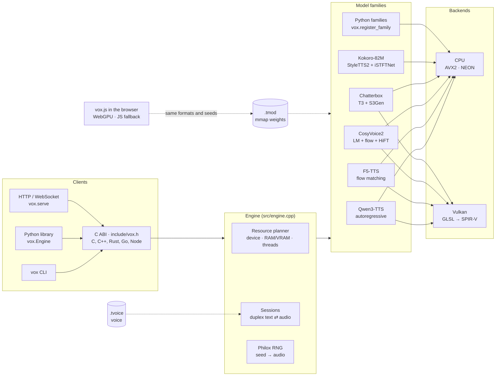

## Models

| Model | Voice | Languages | CPU | Vulkan | Browser | Text input in a session |
|---|---|---|:-:|:-:|:-:|---|
| **Qwen3-TTS Base** 0.6B / 1.7B | clone from a recording + its text | 10 (zh, en, ru, ja, ko, de, fr, …) | ✅ | ✅ | ✅ | word by word |
| **Qwen3-TTS CustomVoice** | built-in speakers, style instruction (1.7B) | same | ✅ | ✅ | ✅ | word by word |
| **Qwen3-TTS VoiceDesign** | a voice from a text description | same | ✅ | ✅ | ✅ | word by word |
| **F5-TTS** v1 / v0 and fine-tunes | clone from a recording + its text | depends on the checkpoint (en/zh base, ru fine-tunes) | ✅ | ✅ whole graph | ✅ | by sentences |
| **Kokoro-82M** *(new in 0.14)* | the named voices of `voices/*.pt` and blends `af_heart,bf_emma` | English with the built-in G2P | ✅ | — | — | by sentences / lines |
| **CosyVoice2-0.5B** *(new in 0.16)* | clone from a recording (with its text: zero-shot, without: cross-lingual), instructions and emotions (instruct2) | zh, en, ja, ko, yue (as trained) | ✅ | ✅ LLM + flow estimator *(0.18)* | — | by groups of sentences |
| **Chatterbox** (English) *(new in 0.17)* | clone from a recording, no transcript needed; the built-in voice; emotions as "exaggeration" | en | ✅ | ✅ T3 + flow estimator *(0.18)* | — | by groups of sentences |

Planned: XTTS, Chatterbox Multilingual / Turbo. Each family describes itself (`vox inspect`, `engine.capabilities`), and the engine takes care
of chunking, crossfades and the commit policy.

## Quick start

    cmake -S . -B build -DVOX_NATIVE=ON && cmake --build build -j
    pip install .                     # Python module (nanobind, scikit-build-core, numpy)

Vulkan is enabled automatically if its headers are found (`libvulkan-dev`). The SPIR-V shaders are stored in the repository (`src/vk_shaders.inc`),
so glslang is needed only if you change them (`python tools/gen_shaders.py`). On Termux, run `pkg install clang cmake python python-numpy` and then the same steps
(the aarch64 build is checked under qemu).

<details>
<summary><b>Qwen3-TTS</b>: convert, clone a voice, synthesize</summary>

    # 1. Hugging Face model → .tmod (q8 is the fastest on CPU; bf16 is unquantized)
    python -m vox build --model ./Qwen3-TTS-12Hz-1.7B-Base --dtype bf16 --quant q8 -o model.q8.tmod

    # 2. voice from a recording, natively, without torch (24 kHz WAV is best, 5–15 s of clean speech)
    vox voice create ref.wav --model model.q8.tmod --text "Текст, который звучит в записи" \
        --name my_voice --lang russian --seed 42 -o voices/my_voice.tvoice

    # 3. synthesis
    vox say "Привет! Это проверка." --model model.q8.tmod --voice voices/my_voice.tvoice -o out.wav
    vox say --stdin --stream --model model.q8.tmod --voice voices/my_voice.tvoice | ffplay -f f32le -ar 24000 -i -

    # 4. server (WAV/PCM streaming, voice creation via POST /v1/voices)
    python -m vox serve --model model.q8.tmod --voices ./voices --port 8080 --device vulkan

</details>

<details open>
<summary><b>Kokoro-82M</b>: convert, pick a voice, synthesize</summary>

    pip install misaki                      # optional: its lexicons are embedded in the .tmod for the built-in G2P
    python -m vox.build_kokoro --model ./Kokoro-82M --dtype bf16 -o kokoro.tmod     # config.json, kokoro-v1_0.pth, voices/*.pt
    vox say "Hello! This is Kokoro running in vox." --model kokoro.tmod --speaker af_heart -o out.wav
    vox voice speaker --model kokoro.tmod --speaker "af_heart,bm_george" -o blend.tvoice        # a blend of two voices
    vox phonemize --model kokoro.tmod "It's 10 o'clock, Dr. Smith."                             # check the G2P

</details>

<details>
<summary><b>CosyVoice2-0.5B</b>: convert, clone, instructions</summary>

    pip install torch pyyaml onnx onnxruntime s3tokenizer   # for the converter only
    python -m vox.build_cosyvoice --model ./CosyVoice2-0.5B -o cosyvoice2.tmod      # LLM bf16, flow and HiFT f32
    vox voice create ref.wav --model cosyvoice2.tmod --text "Text spoken in ref.wav" -o me.tvoice
    vox say "Hello! [laugh] This is CosyVoice2 in vox." --model cosyvoice2.tmod --voice me.tvoice -o out.wav
    vox say "[happy] What a nice day!" --model cosyvoice2.tmod --voice me.tvoice -o happy.wav    # emotion → instruct2
    vox phonemize --model cosyvoice2.tmod "It costs 25 dollars."                                 # the pieces it will speak

</details>

<details>
<summary><b>Chatterbox</b>: convert, built-in voice, clone, exaggeration</summary>

    pip install torch safetensors   # for the converter only
    python -m vox.build_chatterbox --model ./chatterbox -o chatterbox.tmod      # T3 bf16 (--quant q8: 8-bit), S3Gen f32
    vox say "Hello from Chatterbox in vox." --model chatterbox.tmod --speaker default -o out.wav
    vox voice create ref.wav --model chatterbox.tmod -o me.tvoice                    # no transcript needed
    vox say "[excited] We won!" --model chatterbox.tmod --voice me.tvoice -o won.wav  # emotion → exaggeration / cfg_weight
    vox say "Calm down." --model chatterbox.tmod --voice me.tvoice --extra '{"exaggeration":0.3,"cfg_weight":0.5}' -o calm.wav

</details>

<details>
<summary><b>F5-TTS</b>: convert, clone, synthesize</summary>

    python -m vox.build_f5 --ckpt F5TTS_v1_Base/model_1250000.safetensors --vocab F5TTS_v1_Base/vocab.txt \
        --vocos vocos-mel-24khz/ -o f5.tmod                  # DiT in f16 (since 0.18); --quant q8 [--keep-f32 adaln] for 8 bits
    vox voice create ref.wav --model f5.tmod --text "Текст, который сказан в ref.wav" -o me.tvoice
    vox say "Текст для озвучки" --model f5.tmod --voice me.tvoice --device vulkan -o out.wav [--nfe 32 --cfg 2 --sway -1 --speed 1]

</details>

Python:

```python
import vox
eng = vox.Engine("model.q8.tmod", device="vulkan:0")
voice = eng.clone_voice("ref.wav", "Текст референса", name="my_voice", seed=42)
voice.save("my_voice.tvoice")
audio = eng.synthesize("Привет!", voice)                 # numpy float32, 24 kHz
with eng.session(voice, seed=42) as s:                    # text in pieces → audio as it becomes ready
    s.feed("Первая фраза. "); chunks = list(s.ready())
    s.end(); chunks += list(s)

k = vox.Engine("kokoro.tmod")
audio = k.synthesize("Hello there!", k.speaker_voice("af_heart"), speed=1.1)
k.phonemize("Hello there!")        # {'phonemes': …, 'chunks': […], 'g2p': 'misaki' | 'builtin'}
```

## Performance

Measured by the user on vox 0.14.0: `tools/run_full_check.py` on a 16-thread CPU with an RTX 3050 6 GB, Qwen3-TTS 1.7B-Base, about 13 s of speech.
qwentts.cpp (Q8_0) ran on the same machine with the same text. WER and CER were 0 for all nine vox variants and both qwentts.cpp runs.

<p align="center">
  <picture>
    <source media="(prefers-color-scheme: dark)" srcset="docs/img/qwen-rtf-dark.en.svg">
    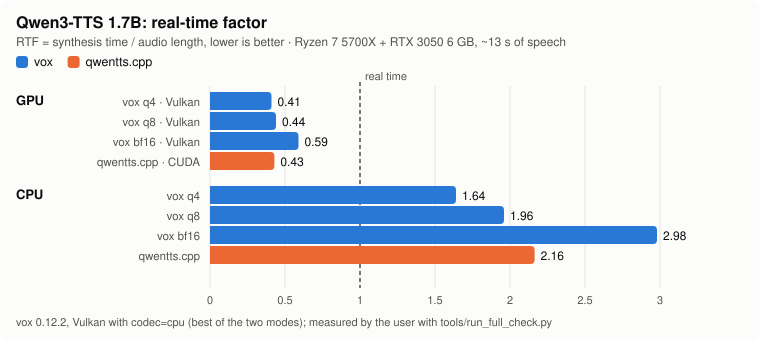
  </picture>
</p>

<p align="center">
  <picture>
    <source media="(prefers-color-scheme: dark)" srcset="docs/img/qwen-memory-dark.en.svg">
    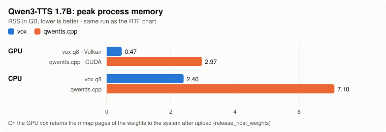
  </picture>
</p>

<details>
<summary>Table of all measured configurations (warm RTF / first chunk / peak RSS)</summary>

| Format | CPU | Vulkan | Vulkan, `codec=cpu` |
|---|---|---|---|
| bf16 | 2.61 / 2133 ms / 3.7 GB | 0.62 / 508 ms / 0.47 GB | 0.59 / 565 ms / 0.93 GB |
| q8 | 1.65 / 2339 ms / 2.4 GB | 0.47 / 490 ms / 0.48 GB | 0.44 / 563 ms / 0.91 GB |
| q4 | 1.35 / 1913 ms / 1.7 GB | 0.44 / 481 ms / 0.46 GB | 0.42 / 546 ms / 0.90 GB |

qwentts.cpp: CUDA 0.426 (2.97 GB), CPU 1.84 (7.1 GB). So vox q8 is about 10% faster than qwentts.cpp on the CPU with 2.9× less memory,
and about 10% slower on the GPU with 6× less memory. q4 does not pass the standard tolerance (KL ≤ 0.02, top-5 ≥ 97%), so q8 is the default.
On the GPU about 70% of the time goes to the talker and predictor matrix-vector products. The predictor makes 160 thousand small calls of 33–50 µs each,
so that is where Qwen3 on the GPU will get faster next.
</details>

F5-TTS on real weights (`hotstone228/F5-TTS-Russian`), a 2.3 s phrase. Since 0.13 the whole DiT step and Vocos run on the GPU:

<p align="center">
  <picture>
    <source media="(prefers-color-scheme: dark)" srcset="docs/img/f5-speed-dark.en.svg">
    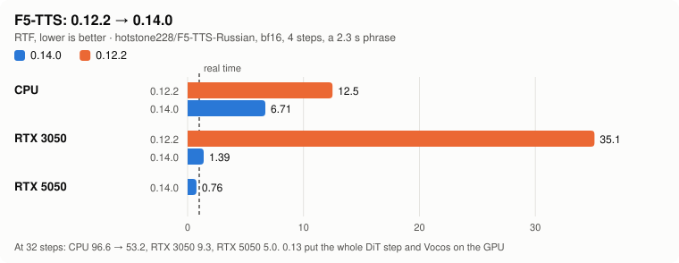
  </picture>
</p>

Kokoro-82M on real weights, on the CPU:

<p align="center">
  <picture>
    <source media="(prefers-color-scheme: dark)" srcset="docs/img/kokoro-cpu-dark.en.svg">
    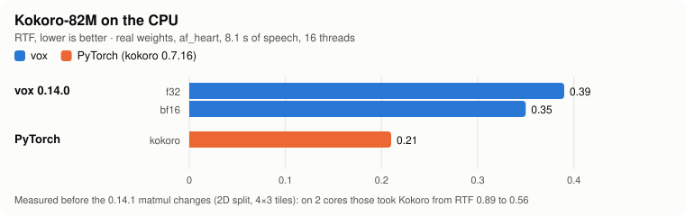
  </picture>
</p>

0.14.1 speeds up every CPU matrix product with many input rows. Each output is computed with the same summation order as before, so the audio is bit for bit the same.
On the 2-core development box this took Kokoro from RTF 0.89 to 0.56, and F5 from 0.52 to 0.35 (f32) or 0.42 (bf16). Your numbers will come from a new run.

**CosyVoice2-0.5B** (0.16, CPU only) was timed with the real dimensions and random weights (`tools/make_tiny_cosyvoice.py --full`) on the same 2-core box.
The LLM takes 96 ms per speech token in bf16 and 59 ms with `--quant q8` (25 tokens make a second of speech, so the LLM alone runs at RTF 2.4 / 1.5).
The flow is the heavy part: its estimator has 56 transformer blocks and 14 residual blocks, run 10 steps × 2 (classifier-free guidance) over the prompt and the new
frames together — 16 s for 2.4 s of speech with a 2.3 s prompt (≈ 1 TFLOP per 4 s of speech). HiFT adds ~0.6 s per second of audio. In total RTF ≈ 7–10 on 2 cores;
a desktop CPU with 8–16 cores should be several times faster, but this model really wants a GPU, which vox does not run it on yet.
These numbers say nothing about quality: the weights were random.

**Chatterbox** (0.17, CPU only), timed the same way (`tools/make_tiny_chatterbox.py --full`, 2 cores, 60 speech tokens = 2.4 s, built-in 3.2 s prompt):
T3 (a 30-layer Llama, two passes per token for classifier-free guidance, run as one batch) took 15.1 s in bf16 and 9.3 s with `--quant q8`, prefill included —
about 250 / 150 ms per token; S3Gen's flow (the same networks as CosyVoice2's) 23.7 s, HiFT 1.8 s. In total RTF ≈ 15–17 on 2 cores, peak RSS 1.8 GB (1.4 GB with q8).

**On the GPU (0.18)**: for CosyVoice2 and Chatterbox the flow estimator — the conditional and the unconditional pass of one Euler step — is one Vulkan
submission (`gpu_f5.cpp`, the F5 kernels plus a causal convolution and Mish), and the token LM (CosyVoice2's Qwen2, Chatterbox's T3 with both CFG
passes) runs on the GPU transformer of Qwen3-TTS with its KV cache in video memory. The flow encoder and HiFT stay on the CPU (they are run once per
piece). Checked on lavapipe against the CPU and the official code (the same tolerances as on the CPU); **speed on a real card not measured yet**.
`--device cpu` keeps everything on the CPU; `vox bench` stats show `flow_device`, `llm_device` / `t3_device` and the GEMM in use.

## How each model runs

<details open>
<summary><b>Qwen3-TTS</b>: autoregressive talker → code predictor → streaming codec decoder</summary>

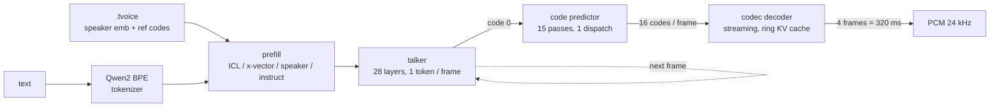

- **The whole pipeline is native**: voice creation (mel spectrogram, ECAPA-TDNN, Mimi encoder with RVQ), talker, code predictor,
  streaming codec decoder. torch is needed only for reference checks.
- **On the GPU**: the talker and the predictor in full. The predictor's 15 passes per frame run as one dispatch with sampling in the
  shader, so each frame needs 2 host synchronizations. The codec decoder runs entirely on the GPU, with one command buffer per chunk.
  `codec=cpu` moves the decoder to the CPU, where it overlaps with the GPU.
- **Models**: `tts_model_type` is read from the checkpoint. Base clones a voice. CustomVoice selects a speaker as a row of `codec_embedding`;
  the 1.7B model also takes an instruction. VoiceDesign builds a voice from a description.

      vox voice speaker --model custom.tmod --speaker aiden --instruct "Speak slowly" -o aiden.tvoice
      vox say "Hello" --model design.tmod --instruct "A deep calm male voice" -o out.wav

- **Decoder modes**: `--decoder stream` (default) decodes continuously, warmed up with the last 50 reference frames.
  `--decoder reference` reproduces `qwen_tts` `chunked_decode` bit for bit (300-frame pieces, 25 frames of context), for
  verification and A/B comparisons.
</details>

<details>
<summary><b>F5-TTS</b>: text → DiT flow matching (NFE steps, CFG) → Vocos</summary>

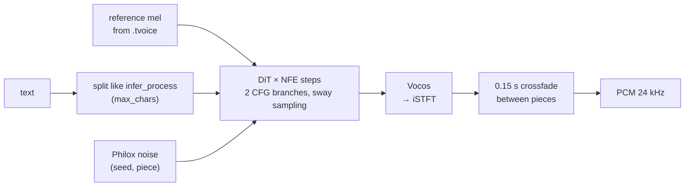

- **The whole DiT step runs as one GPU command buffer** (since 0.13): input projection, convolutional position embedding, every
  block (AdaLN, q/k/v, RoPE, flash attention, FFN) and the output. Vocos runs on the GPU too; only the iSTFT is on the CPU. Set `VOX_F5_GPU=0` to go back to the old path.
- **v0 vs v1 config** (`F5TTS_Base` and fine-tunes such as `hotstone228/F5-TTS-Russian`): `--model-cfg v0|v1`. The converter guesses it from the path,
  and a wrong config produces noise. Reconvert models made with 0.12.1 or older (CRLF `vocab.txt`, Vocos padding).
- **Vocos stays f32** since 0.14.1 (`--vocos-dtype`, +26 MB). It is small but turns mel into phase, so bf16 weights there added waveform error on top of the DiT's own.
  `--dtype` and `--quant` apply to the DiT. Reconvert to get it.
- **GPU kernels in 0.14.1**: linear layers with many rows use a register-blocked GEMM (`gemmb.comp`: a 128×128 tile, 8×8 outputs per thread,
  64 FMAs per 4 vec4 reads from shared memory). Attention reads K and V as vec4. On real cards neither GEMM wins everywhere: after its 0.17.1 fix `gemmb` was
  12–14 % faster on an RTX 5050 and 30–35 % slower on an RTX 3050. **Since 0.18 vox times both** on the model's own layers the first time a graph is built on
  a device and keeps the faster one for the process (`VOX_VERBOSE=1` prints the timing; a software renderer keeps convgemm). `VOX_F5_GEMM=old` / `new`
  forces one, `auto` times even on lavapipe. Both are checked on lavapipe (the audio is the same as on the CPU to 4e-9). `VOX_PROFILE=gpu` shows the share per shader.
- **Precision of the DiT**: `--dtype f16` is the default since 0.18 (the same size as bf16, 8× less weight rounding; activations are f32 either way).
  `--keep-f32 adaln,io,edges` keeps groups of matrices in f32 under any `--dtype` / `--quant` (the AdaLN modulation and the time MLP, the input / output
  projections, the first and last two blocks). Which of them matter on real weights is not known yet: `tools/f5_precision.py` builds the variants and compares
  them with f32 on the same seeds (waveform, log-spectrum, optionally whisper).
- Parameters keep their official names: `nfe_step`, `cfg_strength`, `sway_sampling_coef`, `speed`, `cross_fade_duration`, `target_rms`,
  `use_epss`, `max_chars`. Set them through `--extra`, `extra={...}`, or the short CLI flags `--nfe --cfg --sway --speed`.
- Differences from the official pipeline: Chinese is converted to pinyin character by character, with no word dictionary. The reference is not trimmed by silence (the first 12 s are taken),
  and `fix_duration` is not supported.
</details>

<details open>
<summary><b>Kokoro-82M</b> <i>(new in 0.14)</i>: G2P → PL-BERT → prosody → iSTFTNet</summary>

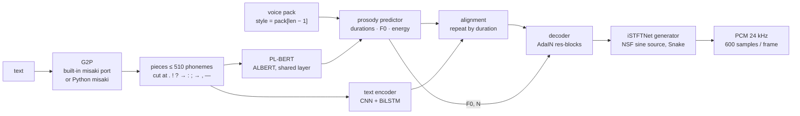

- **Conversion**: `python -m vox.build_kokoro --model DIR` reads `config.json`, the `.pth` checkpoint (weight norm is folded) and `voices/*.pt`.
  All voices go into the `.tmod` as `voice.<name>`. If `misaki` is installed (or `--lexicons DIR` points at its data), its American and British
  gold/silver lexicons are embedded too. Other options are `--dtype f32|f16|bf16` and `--no-g2p`.
- **Voices**: `--speaker af_heart`, or a blend `af_heart,bf_emma` (the packs are averaged, as in `KPipeline`). The server lists them in
  `GET /v1/voices` and accepts them by name. British pronunciation is used when the voice name starts with `b` or when `lang=en-gb` is set.
- **G2P**:
  - **Built-in**: a C++ port of `misaki.en` with the lexicons, stress rules, `-s`/`-ed`/`-ing` stems, numbers, currency, times
    and `[word](/phonemes/)` markup. It needs neither spaCy nor espeak. On `tests/data/g2p_en.txt` it matches misaki (without espeak) in 35 of 40 sentences, and in 92.1% of words for both US and GB.
    Instead of spaCy it uses a heuristic POS tagger. Out-of-vocabulary words are split into lexicon words or spelled letter by letter.
  - **Python `misaki`**: if it is installed, `vox.Engine` uses it for Kokoro by default (`g2p="misaki"`, with the espeak fallback when available). You then get exactly the pieces
    `KPipeline` would produce. Choose explicitly with `g2p="builtin" | "misaki"`.
  - **Ready phonemes**: `extra={"phonemes": true}` (or `--extra '{"phonemes":true}'`) bypasses G2P.
- **Options** (`--extra`, or keyword arguments in Python): `speed`, `phonemes`, `lang` (`en-us` / `en-gb`; other languages are refused by the built-in G2P), `noise_file` (for verification).
- **API**: `vox phonemize --model M [--lang en-gb] "text"`, `vox_engine_phonemize()` in the C ABI, `Engine.phonemize()` in Python.
- Each piece is synthesized as a whole, so audio comes out piece by piece (lines, then pieces of at most 510 phonemes).
</details>

<details open>
<summary><b>CosyVoice2-0.5B</b> <i>(new in 0.16)</i>: Qwen2 LM over speech tokens → flow matching → HiFT</summary>

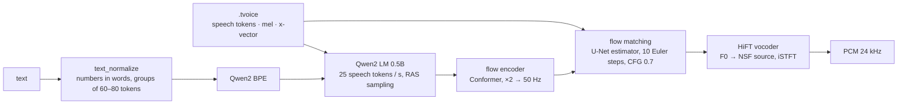

- **Conversion**: `python -m vox.build_cosyvoice --model DIR` (or `python -m vox build --model DIR`) reads the release folder
  (`cosyvoice2.yaml`, `llm.pt`, `flow.pt`, `hift.pt`, `campplus.onnx`, `speech_tokenizer_v2.onnx`, `CosyVoice-BlankEN/`).
  The LLM is stored in `--dtype` (bf16 by default; `--quant q8` puts its linear layers in 8 bits), the flow and HiFT in `--flow-dtype` (f32). The fixed noise of the flow matching
  (`CausalConditionalCFM` draws it with seed 0) is stored too, so the flow is deterministic like the original.
  The CAM++ speaker encoder is read node by node out of `campplus.onnx` (Conv + BatchNorm pairs the exporter folded stay folded) and checked
  against onnxruntime during the conversion; the speech tokenizer goes through `s3tokenizer.utils.onnx2torch`. `--no-clone` leaves both out.
  CAM++ averages its context over segments of 100 frames; the last, incomplete one is divided by 100 (`--campplus-pool window`, the default), as
  `campplus.onnx` runs in onnxruntime up to 1.25 (the official CosyVoice pins 1.18). Newer onnxruntime divides by the frames the segment holds
  (`count`, also what PyTorch does); `--campplus-pool auto` follows the installed one. 0.16.0–0.17.0 used `count` and their converter refused the
  real model; **rebuild CosyVoice2 `.tmod`s with 0.17.1**.
- **Voices are cloned natively**, as `CosyVoiceFrontEnd` does it: the recording (≤ 30 s) is resampled with torchaudio's algorithm, then
  the 24 kHz mel (the flow's prompt), the CAM++ x-vector from a Kaldi fbank at 16 kHz and the S3 speech tokens (S3TokenizerV2: Whisper log-mel, conv + FSMN
  attention encoder, FSQ). With the recording's text the voice is **zero-shot** (text and speech tokens prompt the LLM); without it
  (`--xvector-only`, or a profile recording without text) it is **cross-lingual** (only the flow is prompted).
- **Instructions** (`instruct2`): a style with `--instruct "…"`, or an emotion tag (`[happy]`, `[радостно]`) when the profile has no style of that name.
  The `.tmod` carries the model's own wording of the emotions (the Chinese phrases CosyVoice2 was trained on) and `<|endofprompt|>` is added.
- **Tags**: `[laugh]` becomes the model's `[laughter]` token; `[breath]`, `[cough]`, `[sigh]` are its own. Other tokens of the model
  (`[noise]`, `<strong>…</strong>`, `<laughter>…</laughter>`) can be written in the text as they are.
- **Text**: `text_normalize` without ttsfrd / wetext — Chinese punctuation and bracket rules, numbers spelled out with inflect's rules in other
  text, sentences grouped to 60–80 tokens (`vox phonemize` shows the pieces). Text inside `<|…|>` is passed as is. Every piece goes through
  LLM → flow → HiFT at once (`stream=False` of the original); pieces follow each other without crossfade.
- **Options**: `speed` (the mel is stretched, as in `token2wav`), the seed. The LLM samples with the official RAS rules
  (top-p 0.8, top-k 25, a window of 10 against repeats, end of speech no earlier than 2 tokens per text token) using Philox: the same seed gives the same audio,
  but not the same tokens as PyTorch's random generator.
</details>

<details open>
<summary><b>Chatterbox</b> <i>(new in 0.17)</i>: T3 (Llama over speech tokens, CFG) → S3Gen (flow matching + HiFT)</summary>

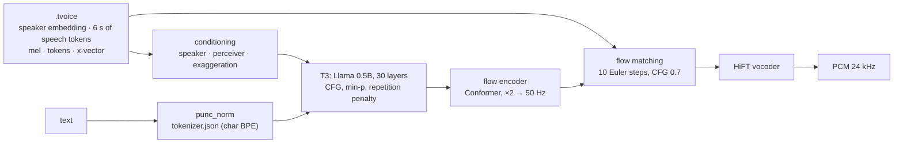

- **Conversion**: `python -m vox.build_chatterbox --model DIR` (or `python -m vox build --model DIR`) reads `t3_cfg.safetensors`, `s3gen.safetensors`,
  `ve.safetensors`, `tokenizer.json` and `conds.pt` (the built-in voice, called `default`). T3 goes to `--dtype` (bf16), its linear layers to 8 bits with
  `--quant q8`; S3Gen stays in f32. S3Gen's sizes are read from the weights; its CAM++ batch norms are folded to scale / shift.
- **T3** is ChatterboxTTS's English model: conditioning rows (the VoiceEncoder embedding projected, a perceiver over up to 150 prompt speech tokens,
  `exaggeration` × a learned vector), the text with its learned positions, two start-of-speech rows; then token by token with classifier-free
  guidance (the unconditional pass sees the text embeddings zeroed), repetition penalty → temperature → min-p → top-p → a draw on Philox.
- **S3Gen** is CosyVoice2's flow and HiFT run without the LLM, with Chatterbox's three differences: the starting noise is drawn per utterance,
  Euler steps take `dt = t[i+1] − t[i]`, and the HiFT source uses the first SineGen. The first 40 ms of every piece get the official fade-in.
- **Voices** are cloned from a recording without its transcript, as `prepare_conditionals` does: 24 kHz (first 10 s) → S3Gen's mel, speech tokens
  and CAM++ x-vector; 16 kHz → the VoiceEncoder embedding (LSTM over 1.6 s windows) and T3's 6-second speech prompt.
- **Emotions**: the manifest maps the engine's emotion tags to Chatterbox settings (`[happy]` → exaggeration 0.8, cfg_weight 0.3; `[calm]` → 0.3 …).
  Options: `exaggeration`, `cfg_weight` (0 = one pass without guidance, which the official code does not allow), `temperature`, `repetition_penalty`,
  `min_p`, `top_p`, `max_new_tokens` (1000), `max_chars` (300: the text is cut into groups of sentences this long; the official code reads it whole).
- **No watermark**: the official `ChatterboxTTS` marks everything it says with Resemble's Perth watermark. vox does not.

</details>

## Voice profiles: several voices, emotions, any model

*New in 0.15.* A `.tvoice` is now a **profile**: one file holds several voices. Each voice has styles (emotions, delivery), the recordings it
was cloned from, the built-in speakers to use on models that cannot clone, and a cache of the voice already built for each model it was used with.

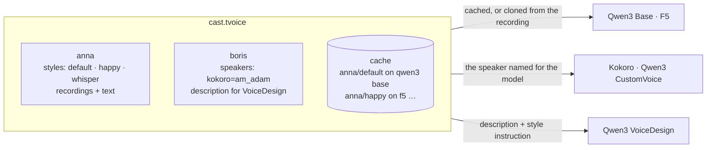

    vox profile new cast.tvoice --name "Cast"
    vox profile add cast.tvoice --voice anna anna.wav --text "What Anna says in the recording"
    vox profile add cast.tvoice --voice anna --style happy anna_happy.wav --text "Something cheerful"
    vox profile set cast.tvoice --voice anna --style whisper --instruct "Whisper softly" --speed 0.95
    vox profile add cast.tvoice --voice boris --from boris.tvoice          # a voice from another file (any model)
    vox profile set cast.tvoice --voice boris --speaker "kokoro=am_adam;qwen3-tts/custom_voice=ryan"
    vox profile show cast.tvoice
    vox profile prepare cast.tvoice --model f5.tmod                        # build every voice for this model now and keep it in the file
    vox say "anna: Hello! [happy] Great news.
    boris: [whisper] Really? [pause 400ms] Tell me." --model f5.tmod --voice cast.tvoice -o dialogue.wav

```python
p = vox.Profile("Cast")
p.add_recording("anna", "anna.wav", "What Anna says in the recording")
p.add_recording("anna", "anna_happy.wav", "Something cheerful", style="happy")
p.set_style("anna", "whisper", instruct="Whisper softly", speed=0.95)
p.set_voice("boris", speakers={"kokoro": "am_adam"})
p.save("cast.tvoice")
audio = engine.synthesize("Hello there.", p, voice_id="anna", style="happy")
audio = engine.synthesize("anna: Hi! [pause 300ms]\nboris: [laugh] Hello.", p)     # markup
```

**One profile on any model.** When a model needs a voice the profile does not yet have a build for, the engine builds it on first use and
`save()` / `vox profile prepare` keeps it:

| model | what the voice is built from |
|---|---|
| Qwen3 Base, F5-TTS (clone from a recording) | the style's recording and its text (the default style's, if the style has none) |
| Kokoro, Qwen3 CustomVoice (built-in speakers) | `speakers` of the voice: `kokoro`, `qwen3-tts/custom_voice` (family or family/variant); CustomVoice 1.7B also gets the style instruction |
| Qwen3 VoiceDesign (voice from a description) | the voice description plus the style instruction |

A voice that cannot be made on a model (for example, no Kokoro speaker named) is a clear error that says what to add.

**Markup in the text** (`markup`: `auto` by default, `strict`, `off`):

| markup | meaning | when the model cannot do it |
|---|---|---|
| `[voice:anna]`, `[anna]`, `anna: …` at the start of a line | switch voice (dialogue lines: profiles with two or more voices) | — |
| `[happy]`, `[style:happy]`, `[радостно]` | a style of the voice; an emotion without its own style is mapped for the model | instruction (Qwen CustomVoice 1.7B, VoiceDesign), else speaking rate (F5, Kokoro), else a note |
| `[/]`, `[neutral]` | back to the default style and speed | — |
| `[pause 500ms]`, `[pause 1.5s]`, `[break]`, `[пауза 300мс]` | exact silence | — |
| `[speed 1.2]` | speaking rate | a note (Qwen3 has no rate control) |
| `[laugh]`, `[sigh]`, `[cough]`, `[смех]` … | a non-verbal sound | the model's own tag if it has one, otherwise a short pause |
| `\[` | a literal bracket | — |

In `auto`, a bracket that is none of these stays text. In `strict` it is dropped, and with `off` everything is read as text. The text
around tags is spoken exactly as if each piece were said alone. What the engine could not do as asked is listed in the session's `notes`
(`session.info["notes"]`). Tags may arrive split across `feed()` calls.

**Compatibility.** A 1.0 `.tvoice` opens as a profile with one voice and speaks bit for bit as before. A profile whose default voice has
a build is saved as format **1.1**: its top level is that voice in the 1.0 layout, so vox 0.14 and vox.js read it as an ordinary voice. A
profile with no build yet is format 2.0, which older versions refuse with a clear message. Recordings are stored in it once, as WAV.

## Vox Studio: the engine from a browser

*New in 0.15.* `vox web` (or `vox -web`) starts the engine with a built-in server and prints links with a secret. Open the **Vox Studio**
page and the engine is controlled from the browser: a script with several voices and markup, playback while it is being synthesized,
voice profiles (record from the microphone, styles, built-in speakers per model), models and devices, and the history of everything
spoken. The page is static (it lives at `vox.arkonova.network/studio/` and is also served by the engine itself); the speech is made on
your machine. The page talks to the engine with HTTP requests, the way a Clash dashboard talks to its core.
*0.19*: a new interface — a side rail, takes with large voice-coloured waveforms ("Another take" with a new seed, "To the editor"), who speaks as
voice badges above the editor, an emotion menu, settings grouped with short explanations (a sheet on narrow screens), model cards with
"Fit to this computer" (`vox tune`), history search, light and dark themes; profiles with the same name are told apart by their file.

    vox web --models ./models --voices ./voices
      Vox Studio:  https://vox.arkonova.network/studio/#url=http%3A%2F%2F127.0.0.1%3A7860&secret=…
      this engine: http://127.0.0.1:7860/studio/#secret=…
    vox web --models ./models --host 0.0.0.0 --tls      # for other computers: https with a self-signed certificate

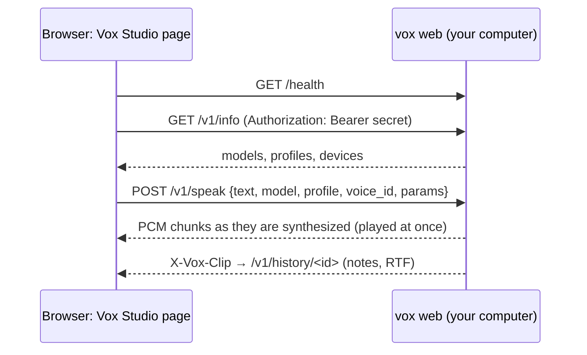

- **Secret.** Every `/v1` request needs it (`Authorization: Bearer …`, or `?token=` for audio links and WebSockets). The secret travels in the
  link's `#fragment`, which browsers never send to the site hosting the page. It is stored in `~/.vox/web_secret`; `--new-secret` makes a new one.
- **Reaching the engine.** An https page may call `http://127.0.0.1` / `localhost` (Chrome may ask once to allow local network access).
  From another computer it may not call plain http, so there are three ways:
  - `--tls`: a self-signed certificate is made for this machine's names and addresses; open the engine's `https://…/health` once and accept it.
  - `--cert` / `--key` with your own certificate.
  - The Studio that the engine serves itself (`http://HOST:PORT/studio/`).
- **API** (for your own clients too): models (`/v1/models`, load / unload / add), profiles (`/v1/profiles`: create, PATCH, recordings,
  prepare, download / upload), `POST /v1/speak` (streamed pcm16 / f32 / wav), `/v1/history`, and WebSocket `/v1/duplex` (the protocol of
  `vox serve`). The full list is at the top of `python/vox/web.py`.

## Self-tuning: `vox tune`

*New in 0.19.* Which device and placement are fastest depends on the model and the computer (an RTX 5050 runs F5 faster with one GEMM,
an RTX 3050 with the other; a small model may be faster on 16 CPU cores than on a laptop GPU). `vox tune` measures instead of guessing:

    vox tune --model cosyvoice2.tmod --voice me.tvoice       # a model with built-in speakers needs no voice
      [1/7] vulkan:0 (NVIDIA GeForce RTX 5050)        RTF 0.53, first sound 5393 ms, GEMM convgemm
      [2/7] vulkan:1 (NVIDIA GeForce RTX 3050)        RTF 0.59, first sound 5995 ms, GEMM convgemm
      [3/7] cpu, 8 threads                            stopped: slower than the best so far
      …
    best: vulkan:0 (…); saved to ~/.cache/vox/tune.json
    vox say "…" --model cosyvoice2.tmod --voice me.tvoice    # device auto now opens it on vulkan:0

- **Candidates** (`vox tune --show` lists them): every non-software GPU with the default placement, and with each *light* GPU-capable stage
  (under a quarter of the GPU weights: Qwen3's codec decoder, F5's Vocos) moved to the CPU; then the CPU with a thread per physical core,
  with every logical CPU (SMT) and with ¾ of the cores. Heavy stages on the CPU were 3–10× slower in every measurement, so they are no longer
  tried (`--device vulkan:0,flow=cpu` still works by hand). GPUs go first: a candidate whose synthesis passes twice the best one's (+3 s;
  the whole run is also capped at 3× the best's wall time, at least 90 s) is stopped, and once one CPU thread count is stopped the other
  CPU ones are not run. Results within 3 % of the fastest count as a tie: the first of them (the plain configuration) is kept.
  `--candidates JSON` measures a list of your own.
- **GEMM is not a separate candidate**: for F5 and the flow models every GPU candidate times convgemm against gemmb on the model's own
  layers when its graph is built, and keeps the faster one; the row shows which one won (`GEMM gemmb`) and the result records it.
- Each candidate runs in its own child process (`vox bench`; one Vulkan device per process), on a short text in the model's language.
  `--goal latency` keeps the earliest first sound instead of the lowest RTF; `--runs N`, `--text`.
- **Applying it**: an engine opened with the default resources (`device` auto, no threads, placement or layers) looks up the model and the
  hardware (CPU, cores, RAM, every GPU and its driver) and opens with the measured configuration; `vox plan` shows `tuned: …`.
  Anything explicit wins, and `VOX_TUNE=0` or `{"tuned": false}` turns it off. A new GPU, a driver update or a rebuilt model are new keys.
- Python: `vox.tune(model, voice)` (progress callback, the same cache), `vox.tune_info(model)`; the Studio has "Fit to this computer"
  on every model (`POST /v1/models/tune`). `vox tune --forget` removes a result.

## Resources: device, memory, mode

    vox devices [--json]                          # CPU, RAM, GPUs with indices and free video memory
    vox plan --model m.tmod --mode memory --ram-limit 3GiB --vram-limit 2GiB     # plan without loading weights
    vox say "…" --model m.tmod --voice v.tvoice --device gpu:1 --mode balanced --threads 6 --affinity 0-5 \
        --priority low --ram-limit 6GiB --vram-limit 3GiB --place codec=cpu --gpu-layers talker=14 --max-sessions 2
    --config resources.json                       # the same as a JSON file; command-line flags override it

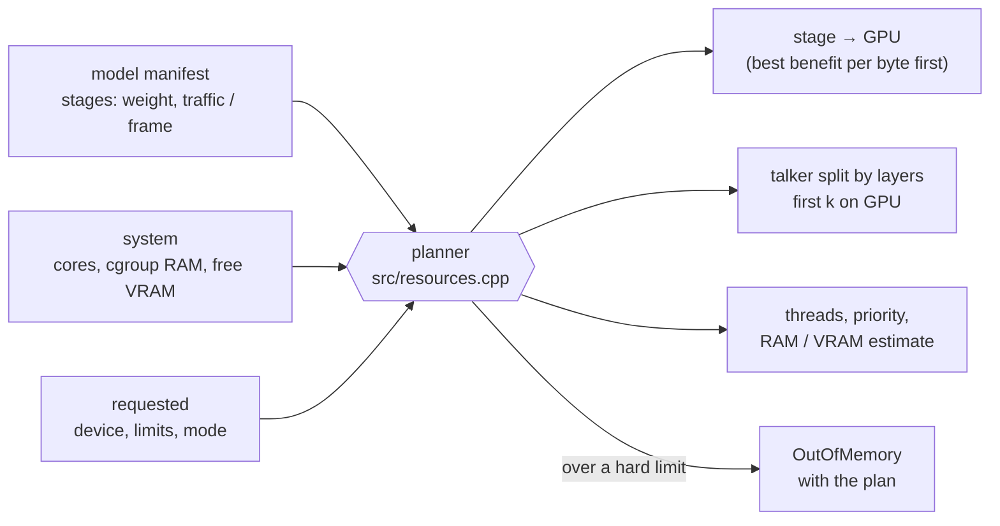

<details>
<summary>Details: modes, limits, devices</summary>

- **Modes** count *physical* cores (0.19.1: SMT siblings share the FMA units and the cache, and 16 threads on an 8-core Ryzen were 37 %
  slower than 8): `speed` a thread per core with busy-waiting; `balanced` (the default) a thread per core too on an SMT CPU (the siblings
  are left to the OS), one core fewer without SMT; `memory` half the cores with no busy-waiting; `background` a quarter at low priority, no
  GPU. `--threads N` overrides (`vox devices` shows `cpu_physical`).
- **Limits are hard**. If the plan goes over `ram_limit` / `vram_limit`, the model is refused (`OutOfMemory`, with the plan in the message)
  unless `enforce=false`. A session that does not fit in what is left of the limit is not created, and `max_sessions` caps how many there are.
  After upload to the GPU, the weights' mmap pages are returned to the system (`--no-release` turns this off).
- Each engine has its own CPU thread pool, pinned to cores and `nice`d. Two engines with different thread counts give the same result.
- `--device cpu | auto | gpu[:N] | vulkan | vulkan:N`, plus `,strict` (an error if a matrix does not fit) and `,<stage>=cpu|gpu` for any stage
  `vox plan` lists (`codec=cpu`, `flow=cpu`, `t3=cpu`, …).
  Vulkan numbering does not match nvidia-smi or CUDA, so go by the names that `vox devices` prints. Software renderers (llvmpipe) are never picked by `auto`.
- vox reports on stderr what went to VRAM and why; it never falls back silently. One Vulkan device per process.
- Python: `vox.devices()`, `vox.plan(model, vox.Resources(...))`, `vox.inspect(model)`, `eng.stats()`, `eng.benchmark(...)`.
  Errors are `vox.VoxError`, `vox.OutOfMemory` and `vox.DeviceError`.
</details>

## Duplex streaming

Text can be fed on the fly while audio is pulled as it becomes ready. It also works the other way round: type text and get back a single recording.
The engine handles the plumbing: it knows how each model accepts text and decides what to hand it and when.

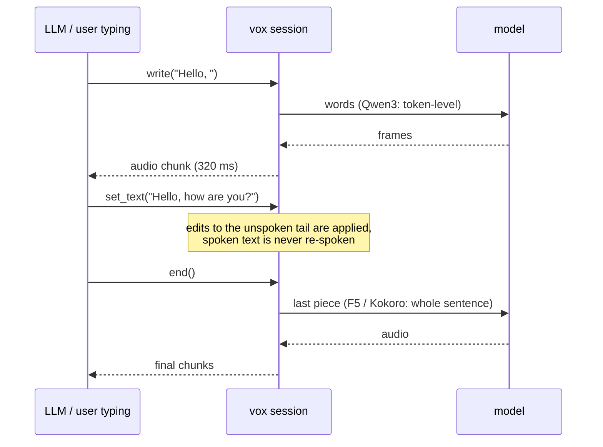

| Model | how it reads text | what the engine does |
|---|---|---|
| Qwen3-TTS | word by word (`text_in: token`) | hands over words as they arrive, holds back an unfinished word |
| F5-TTS, Kokoro | whole pieces (`text_in: chunk`) | accumulates text up to the end of a sentence (or a typing pause `idle_ms`); with `auto` the result matches synthesizing the whole text at once |

    with engine.duplex(voice, commit="auto", idle_ms=600) as d:       # Python
        d.write("Привет, "); d.write("как дела?"); d.end()           # from any thread
        for chunk in d.audio(): play(chunk)                           # aaudio() for asyncio, final() gives one recording
    printf 'Привет. Как дела?' | vox live --model m.tmod --voice v.tvoice -o out.wav --commit sentence
    # HTTP: WebSocket /v1/duplex — {"type":"start"|"text"|"set_text"|"flush"|"end"|"cancel"}, audio as binary PCM frames

Commit policy (`commit`): `auto`, `sentence` or `manual` (nothing goes out until `flush()` / `end()`). On a conflict with text that has already been spoken:
`keep` | `raise` | `respeak`.

## Browser: vox.js

A single script with no dependencies (`docs/vox.js`, ES module `docs/vox.mjs`) that runs **F5-TTS and Qwen3-TTS** on WebGPU. Without WebGPU it falls back to a JS CPU backend.

```html
<script src="vox.js"></script>
<script type="module">
  const f5 = await Vox.load("hf:SWivid/F5-TTS", { dtype: "bf16", onProgress: (p) => console.log(p) });
  const voice = await f5.cloneVoice(refFile, "Текст, который сказан в записи");
  const { pcm, sampleRate } = await f5.synthesize("Привет, мир!", { voice, nfe_step: 16, seed: 1 });
  Vox.play(pcm, sampleRate);

  const q = await Vox.load("hf:Qwen/Qwen3-TTS-12Hz-0.6B-CustomVoice", { dtype: "bf16" });
  const v = q.speakerVoice(q.speakers[0], "", { language: "english" });
  for await (const piece of q.stream("Long text.", { voice: v, seed: 1 })) { /* audio pieces */ }
</script>
```

<details>
<summary>Loading by link, caching, GPU load, limitations</summary>

- `Vox.load` accepts a Hugging Face repository (`hf:org/name`, a page link, `tree`/`resolve`), a direct link, a `.tmod`, a `File`/`Blob`, or a set of files.
  Checkpoints are converted in the browser with the same transformations as the Python converters (for Qwen3, byte for byte per tensor).
  Qwen3 is read tensor by tensor through HTTP Range requests in 8 MiB blocks, six in parallel, straight into video memory. Blocks are cached in the Cache API, so a second load downloads nothing.
- Options: `dtype`, `quant: "q8"`, `token`, `hfHost`, `backend` (`auto` | `webgpu` | `cpu`), `load` (`balanced` | `gentle` | `full`),
  `cache`, `blockMiB`, `modelCfg` (F5 v0/v1). `Vox.convert(src)` returns `.tmod` bytes.
- Work is submitted in slices of about 30 ms with pauses between them, so the OS, the browser and the driver watchdog stay responsive (`model.gpu.setLoad(...)`).
- Qwen3 Base voice cloning from a recording runs in the browser (`model.cloneVoice(audio, refText)` → `voice.toTvoice()`).
- The same `seed` gives the same audio as `vox say --seed`.
- **Not verified**: real video cards and drivers (the tests use SwiftShader), real weights in the browser, Safari and Firefox, the real huggingface.co.
- Limitations: computation is in f32 (no f16 or cooperative matrix), the KV cache is f32, Qwen makes 16 GPU round trips per frame, q4 is not built in the browser,
  and the CPU fallback is single-threaded JS. Kokoro is not in the browser yet.
</details>

## What is verified

Every family is built tiny with **the official PyTorch classes** and random weights (the same modules, tensor names and dataflow as the
real checkpoints, only narrow), then compared with vox stage by stage. CI runs this on the CPU and on software Vulkan (lavapipe).

| Family | Reference | Result |
|---|---|---|
| Qwen3-TTS | `qwen_tts` 0.1.1 (`generate_voice_clone`, `generate_custom_voice`, `generate_voice_design`) | speaker embedding ≤ 4e-7; reference codes match 100%; talker / predictor logits ≤ 1e-6 / 1e-5 with argmax 100%; decoder audio ≤ 3e-4; on a **real 1.7B-Base**: logits ≤ 2.6e-4, argmax 100% |
| F5-TTS | `f5_tts` + `vocos` | tokenizer, mel, text encoder, DiT (both CFG branches), Vocos, the CFM loop ~1e-6; end-to-end audio 3e-9; GPU graph on lavapipe 4e-9; **real** `hotstone228/F5-TTS-Russian`: mel ~5e-6 (f32), the same error on CPU, RTX 3050 and RTX 5050 |
| CosyVoice2 | the CosyVoice repository (`CosyVoice2Model`, `CosyVoiceFrontEnd`), onnxruntime, s3tokenizer | 24 kHz mel 2e-6, fbank 3e-5, CAM++ x-vector 2.5e-7, Whisper mel 2e-5, speech tokens 100%, LLM log-probs 2e-7 with argmax 100%, flow mel 3e-7, HiFT audio 1.4e-4 (rel.); whole utterances through the engine (voice from the WAV, the official tokens and noise) 7e-6–1.4e-5 max \|Δ\| in all three modes; text pieces identical to `text_normalize` on 8 texts. **real CosyVoice2-0.5B** (0.17.1, by the author of vox): whisper hears English and Chinese word for word (bf16 and q8), `[happy]` / `[laugh]` work; no side-by-side with the official code (its frontend needs ttsfrd / wetext) |
| Chatterbox | `chatterbox-tts` 0.1.7 (`ChatterboxTTS.generate`, `prepare_conditionals`) | text tokens 100% on 8 texts; VoiceEncoder 7e-7, T3 conditioning 3e-7, T3 CFG logits 1e-6 on every step, flow mel 4e-7, HiFT F0 5e-7, audio 6e-5 (rel.); whole utterances through the engine (built-in voice, the official tokens and noise, four sets of options) 4e-6–1.3e-5 max \|Δ\|; a cloned voice: S3Gen prompt identical, VoiceEncoder cosine 0.999997. **real ResembleAI/chatterbox** (0.17.1, by the author of vox): the built-in voice and a clone are heard word for word (bf16, q8); CPU RTF 3.5–4.2 against 4.2 for the official torch code |
| Kokoro-82M | `kokoro` 0.7.16 + `misaki` 0.7.4 (`KModel`, `KPipeline`) | every stage (PL-BERT, duration encoder, durations, F0/N, text encoder, alignment, NSF source, STFT, generator) to ~1e-6; same length in all end-to-end scenarios, log-mel 0.16–0.71 dB (2.64 dB with a different noise); G2P 92.1% of words vs misaki; **real Kokoro-82M**: same length as the official (8.000 s), mean \|Δ log-mel\| 0.125, whisper hears the same words |
| vox.js | the core and the official dumps | F5 audio 3.7e-9; Qwen3 conversion byte for byte, audio = `vox say --seed`; CPU fallback < 1e-4 |
| Bindings | `vox say --seed 42` | C, C++, Rust, Go, Node.js, Python ctypes: bit for bit |

`vox verify` runs the reference codes with teacher forcing and compares every step's logits and the decoder audio. For q8 it checks mean KL (≤ 0.02)
and top-5 (≥ 97%) instead of argmax.

<details>
<summary>Full run on your machine: <code>tools/run_full_check.py</code></summary>

    python tools/run_full_check.py --model-dir ./Qwen3-TTS-12Hz-1.7B-Base --ref-audio ref.wav \
        --ref-text "Текст референса" --lang russian --dtypes bf16,q8 \
        --devices "cpu;vulkan:1,strict;vulkan:1,codec=cpu,strict" --threads 8 \
        --external "qwentts.cpp=./qwentts-cli --model m.gguf --out {out} < {text_file}" \
        --external-time 'qwentts.cpp=\[Perf\] Total:\s*([\d.]+)\s*ms' \
        --wer --asr-cmd 'whisper-cli -m ggml-small.bin -l {lang} -nt -np -f {wav}' --out work/

The run converts the weights, creates a voice natively and compares it with `qwen_tts`, takes PyTorch dumps, checks each format × device pair,
and measures speed (cold and warm start, first chunk, peak memory, per-stage and GPU profiles). It then runs the external engine on the same text
and, with `--wer`, estimates intelligibility with whisper. The result is written to `work/report.md`. Profiles: `VOX_PROFILE=1` (CPU stages), `VOX_PROFILE=gpu`
(GPU timestamps per shader), `VOX_PROFILE=f5`, `VOX_PROFILE=kokoro`.

To check a reference before creating a voice, run `python tools/check_reference.py ref.wav --ref-text "..."`. An extra word at the start of the synthesis almost always means that the reference text does not match the recording.
</details>

## Formats

- `.tmod`: a `VOXM` header, a JSON manifest (stages, precision, tokenizer, generation parameters, voices) and blobs aligned to 4096 bytes for mmap.
- `.tvoice`: safetensors. Since 0.15 it is a profile (metadata `profile`: voices, styles, recordings, cache index; tensors `ref.<id>` and `c<N>.*`);
  the default voice's build sits at the top level in the 1.0 layout (`speaker_emb`, `ref_codes`, `ref_text_tokens`, `ref_audio`, metadata `voice`). A build is bound to the weights by sha256.
  A `speaker` voice (built-in speaker, description, Kokoro voice or blend) stores the speaker name and is tied to the model variant.
- **Q4**: 4 bits per weight in blocks of 32. `--quant q4` covers the talker attention and MLP, `q4mlp` only the MLP, `q4full` everything. On the RTX 3050 it is faster and uses a
  third less VRAM, but it does not pass the KL/top-5 tolerance. WER on five phrases was 0.12–0.18 against 0.07 for q8, with no audible difference on clones.

## From other languages

All bindings go through the C ABI. `examples/` has C (`minimal.c`), C++ (`minimal.cpp`), Rust (`rust/`), Go (`go/`, cgo), Node.js (`node/`, koffi)
and Python ctypes. `tests/test_examples.py` builds each one and requires the audio to match `vox say --seed 42` bit for bit.
A model can also be written entirely in Python and registered with `vox.register_family`: see [docs/python-backends.md](docs/python-backends.md).

## Project page

`site/` holds the sources of the [project page](https://dariumi.github.io/Vox/), which has a live WebGPU demo. Build it into `docs/` with `python tools/build_site.py`.
The code examples on the page come straight from `examples/`, so they are the same files the tests check. The charts are generated from measured numbers
by `python tools/make_charts.py`.

## Code layout

| path | what |
|---|---|
| `include/vox.h` | C ABI: engine / voice / session, pull streaming, cancellation, phonemize |
| `src/engine.cpp` | ABI implementation, sampling, chunks, duplex sessions, the "GPU generates, CPU decodes" pipeline |
| `src/backend_qwen3.cpp`, `src/qwen3.cpp`, `src/qwen3_voice.cpp` | Qwen3-TTS: prefill modes, talker, predictor, decoder; voice creation (mel, ECAPA-TDNN, Mimi, RVQ) |
| `src/f5.cpp`, `src/f5_ops.cpp`, `src/backend_f5.cpp`, `src/gpu_f5.cpp` | F5-TTS: tokenizer, DiT + CFM, Vocos, text splitting and crossfade, the Vulkan DiT graph; the Vulkan flow estimator of CosyVoice2 / Chatterbox |
| `src/kokoro.cpp`, `src/backend_kokoro.cpp` | Kokoro-82M: PL-BERT, prosody predictor, text encoder, decoder, iSTFTNet generator |
| `src/kokoro_g2p.cpp`, `src/kokoro_g2p_en.cpp` | English G2P (a port of misaki.en) and the KPipeline-style piece splitting |
| `src/cosyvoice.cpp`, `src/cosyvoice_front.cpp`, `src/backend_cosyvoice.cpp` | CosyVoice2: Qwen2 LM, flow (Conformer + CFM), HiFT; mel / fbank / CAM++ / S3 tokenizer; text frontend |
| `src/chatterbox.cpp`, `src/backend_chatterbox.cpp`, `src/hf_tokenizer.cpp` | Chatterbox: T3, VoiceEncoder, piece splitting; a `tokenizer.json` (BPE) reader |
| `src/nn.cpp` | layers shared by the convolutional models (convolutions, NSF source, STFT / iSTFT, attention, torchaudio resampler) |
| `src/profile.cpp`, `src/markup.cpp` | voice profiles (format, merge patch, cross-model building) and the text markup |
| `src/resources.cpp`, `src/family.cpp`, `src/tune.cpp` | resource planner and session budget; registry of model families (C++ and Python); the `vox tune` cache and candidates |
| `src/kernels.cpp` | thread pools, matmul (f32/f16/bf16, q8 and q4 int8-dot AVX2), transformer (including the GPU/CPU hybrid) |
| `src/gpu_vulkan.cpp`, `src/gpu_codec.cpp`, `src/shaders/*.comp` | Vulkan: matmul, transformer, codec decoder, profiler; GLSL shaders (SPIR-V in `src/vk_shaders.inc`) |
| `webgpu/wgsl/`, `webgpu/web/src/` | WGSL shaders and the `vox.js` sources (`tools/build_web.py`) |
| `python/vox` | Python API, converters `vox.build` / `vox.build_f5` / `vox.build_kokoro` / `vox.build_cosyvoice` / `vox.build_chatterbox`, server `vox.serve`, misaki frontend |
| `site/`, `docs/` | the project page and its GitHub Pages build; `docs/img/` holds the charts |
| `tools/` | references, the full run, tiny models (`make_tiny_*.py`), charts |
| `tests/`, `examples/` | unit and reference tests; clients in six languages |

## Tests

    tests/run_all.sh          # C++, tokenizer, Qwen3 / F5 / Kokoro against the official code (if torch and the packages are installed),
                              # examples in 6 languages, vox.js in Chromium (if playwright is available), Python, server, duplex, Q4
    VOX_QWEN2_GGUF=qwen2.gguf VOX_TEST_DEVICES="cpu;vulkan:0" python tests/test_official.py build/vox
    python tests/test_kokoro_tiny.py build/vox
    VOX_COSYVOICE_SRC=CosyVoice VOX_QWEN2_GGUF=qwen2.gguf python tests/test_cosyvoice_tiny.py build/vox   # a clone of FunAudioLLM/CosyVoice
    python tests/test_chatterbox_tiny.py build/vox                                                        # pip install chatterbox-tts

Test vocabulary: `curl -L -o qwen2.gguf https://raw.githubusercontent.com/ggml-org/llama.cpp/master/models/ggml-vocab-qwen2.gguf`.
CI (`.github/workflows/ci.yml`) runs all of this on the CPU and on lavapipe.

## Limitations

- Native GPU support is Vulkan only (no CUDA or Metal). The shaders are generic, with no tensor cores or cooperative matrix. One Vulkan device per process.
- **Kokoro**: CPU only (no Vulkan and no browser yet). The built-in G2P is English only and differs from misaki on a few words
  (a heuristic tagger instead of spaCy, no espeak). On real weights it is about 1.7× slower than PyTorch on 16 threads (measured on 0.14.0, before the 0.14.1 matrix-product speedup).
- F5-TTS at 32 steps is still slower than real time on the GPU (RTF 5 on an RTX 5050). Its graph needs `dim_head ≤ 64`, which every official checkpoint satisfies.
- **CosyVoice2**: on the GPU only the LLM and the flow estimator (the encoder, HiFT and the cloning frontend run on the CPU). The text frontend has no ttsfrd / wetext (Chinese numbers stay digits, as in the official code without them). Audio comes out per group
  of sentences, not token by token (the official bidirectional streaming mode is not implemented). Checked against the official code on a tiny model only.
- **Chatterbox**: on the GPU only T3 and the flow estimator (the encoder, HiFT, VoiceEncoder on the CPU); English only (not the Multilingual or Turbo models). Audio comes per group of sentences. For T3's speech prompt a cloned voice
  is resampled to 16 kHz with torchaudio's algorithm, the official code uses soxr: S3Gen's prompt and the speaker embedding come out the same,
  part of T3's 150 prompt tokens can differ. Checked against the official code on a tiny model only.
- The main path is built for autoregressive codec models. Non-AR models use the "direct" mode of `Backend`, as F5, Kokoro, CosyVoice2 and Chatterbox do. XTTS is not supported yet.
- The official `non_streaming_mode=True` (the whole text in the prefill) is not implemented. A Python backend runs on the CPU in the interpreter and is meant for prototypes.
- GPU sampling uses float and CPU sampling uses double. The same seed on the same device gives the same audio.
- Voice input resampling is sinc/Kaiser. It matches `qwen_tts` (soxr) bit for bit only for 24 kHz WAV.
- NFC normalization is done in the Python wrapper. From the CLI and the C ABI, pass text that is already in NFC.
- The aarch64 build is checked under qemu. The macOS and Windows RAM/core probes have not been run.

## License

Apache-2.0 (see `LICENSE`). `third_party/json.hpp` is nlohmann/json (MIT). Model weights are distributed under their own licenses and are not part of the repository.
