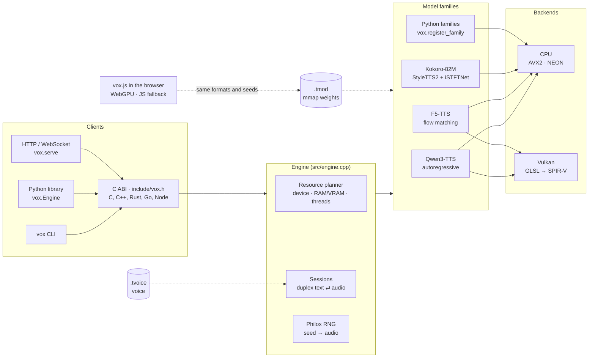
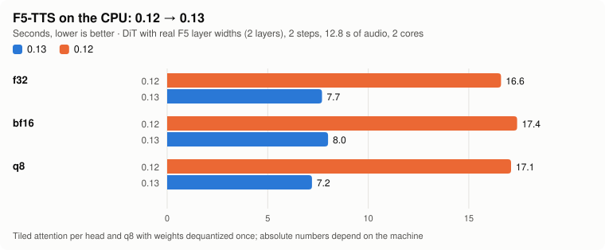
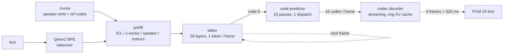
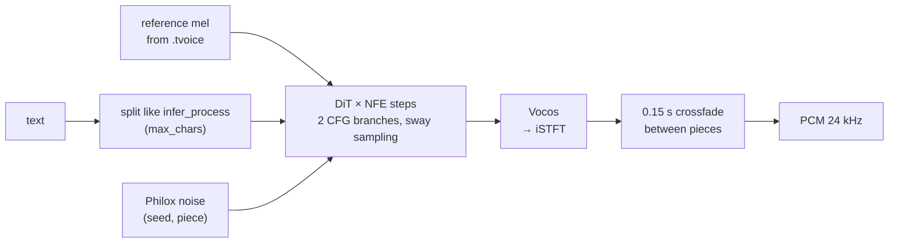
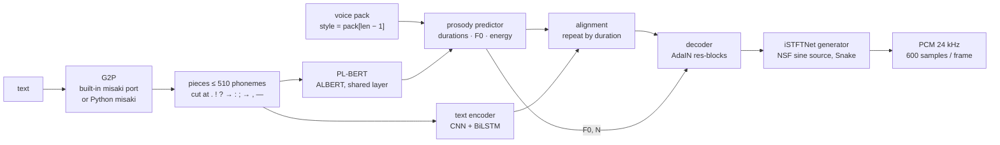
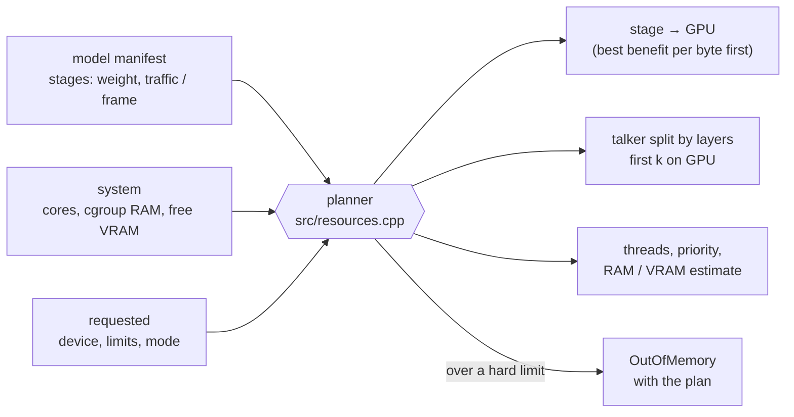
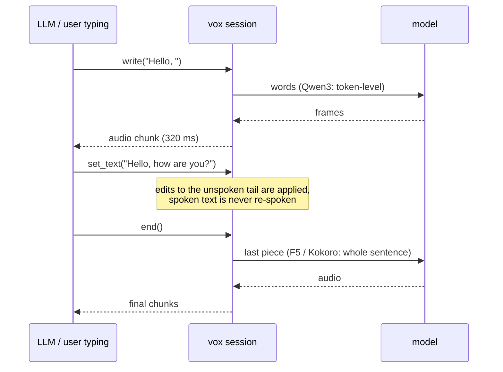

**English** | [Русский](README.ru.md)

<p align="center">
  <picture>
    <source media="(prefers-color-scheme: dark)" srcset="docs/img/banner-dark.en.svg">
    
  </picture>
</p>

<p align="center">
  <a href="https://github.com/dariumi/Vox/actions/workflows/ci.yml"></a>
  
  
  
  
</p>

<p align="center">
  <a href="https://dariumi.github.io/Vox/">Project page and live demo</a> ·
  <a href="#quick-start">Quick start</a> ·
  <a href="#models">Models</a> ·
  <a href="#performance">Performance</a> ·
  <a href="#what-is-verified">What is verified</a> ·
  <a href="CHANGELOG.md">Changelog</a>
</p>

**vox** is a speech synthesis engine written in C++17. You can use it through a C ABI (`include/vox.h`), the `vox` CLI, the `vox`
Python **library**, an HTTP/WebSocket server, or the `vox.js` browser library. It does not depend on PyTorch, ggml or any other external library.
Weights are mmapped from a single `.tmod` file and voices are stored as `.tvoice`. It runs on the CPU (x86-64 AVX2, aarch64), on Vulkan
(NVIDIA / AMD / Intel / Android) and on WebGPU in the browser, with f32 / f16 / bf16 / q8 / q4 weights.

| | |
|---|---|
| 🧩 **Several model families, one runtime** | Qwen3-TTS (cloning, built-in speakers, voice from a description), F5-TTS (cloning, flow matching), Kokoro-82M (named voices and voice blends). New families plug in from C++ or Python. |
| 🎛️ **Resource control** | You pick the device, RAM and VRAM limits, thread count and priority, and a mode (speed / balanced / memory / background). `vox plan` shows where each stage will go without loading the weights. |
| 🔁 **Streaming both ways** | Text can arrive word by word from an LLM while audio comes out in chunks. Edits to the part that has not been spoken yet are applied. |
| 🎯 **Checked against the official code** | Every family is compared stage by stage with its official PyTorch implementation (see [What is verified](#what-is-verified)). |
| 🎲 **Deterministic** | Noise and sampling come from Philox. The audio depends only on the seed, never on thread count or chunk size, and `vox.js` produces the same samples as the core. |

## Architecture



## Models

| Model | Voice | Languages | CPU | Vulkan | Browser | Text input in a session |
|---|---|---|:-:|:-:|:-:|---|
| **Qwen3-TTS Base** 0.6B / 1.7B | clone from a recording + its text | 10 (zh, en, ru, ja, ko, de, fr, …) | ✅ | ✅ | ✅ | word by word |
| **Qwen3-TTS CustomVoice** | built-in speakers, style instruction (1.7B) | same | ✅ | ✅ | ✅ | word by word |
| **Qwen3-TTS VoiceDesign** | a voice from a text description | same | ✅ | ✅ | ✅ | word by word |
| **F5-TTS** v1 / v0 and fine-tunes | clone from a recording + its text | depends on the checkpoint (en/zh base, ru fine-tunes) | ✅ | ✅ whole graph | ✅ | by sentences |
| **Kokoro-82M** *(new in 0.14)* | the named voices of `voices/*.pt` and blends `af_heart,bf_emma` | English with the built-in G2P | ✅ | — | — | by sentences / lines |

Planned: XTTS, CosyVoice, Chatterbox. Each family describes itself (`vox inspect`, `engine.capabilities`), and the engine takes care
of chunking, crossfades and the commit policy.

## Quick start

    cmake -S . -B build -DVOX_NATIVE=ON && cmake --build build -j
    pip install .                     # Python module (nanobind, scikit-build-core, numpy)

Vulkan is enabled automatically if its headers are found (`libvulkan-dev`). The SPIR-V shaders are stored in the repository (`src/vk_shaders.inc`),
so glslang is needed only if you change them (`python tools/gen_shaders.py`). On Termux, run `pkg install clang cmake python python-numpy` and then the same steps
(the aarch64 build is checked under qemu).

<details>
<summary><b>Qwen3-TTS</b>: convert, clone a voice, synthesize</summary>

    # 1. Hugging Face model → .tmod (q8 is the fastest on CPU; bf16 is unquantized)
    python -m vox build --model ./Qwen3-TTS-12Hz-1.7B-Base --dtype bf16 --quant q8 -o model.q8.tmod

    # 2. voice from a recording, natively, without torch (24 kHz WAV is best, 5–15 s of clean speech)
    vox voice create ref.wav --model model.q8.tmod --text "Текст, который звучит в записи" \
        --name my_voice --lang russian --seed 42 -o voices/my_voice.tvoice

    # 3. synthesis
    vox say "Привет! Это проверка." --model model.q8.tmod --voice voices/my_voice.tvoice -o out.wav
    vox say --stdin --stream --model model.q8.tmod --voice voices/my_voice.tvoice | ffplay -f f32le -ar 24000 -i -

    # 4. server (WAV/PCM streaming, voice creation via POST /v1/voices)
    python -m vox serve --model model.q8.tmod --voices ./voices --port 8080 --device vulkan

</details>

<details open>
<summary><b>Kokoro-82M</b>: convert, pick a voice, synthesize</summary>

    pip install misaki                      # optional: its lexicons are embedded in the .tmod for the built-in G2P
    python -m vox.build_kokoro --model ./Kokoro-82M --dtype bf16 -o kokoro.tmod     # config.json, kokoro-v1_0.pth, voices/*.pt
    vox say "Hello! This is Kokoro running in vox." --model kokoro.tmod --speaker af_heart -o out.wav
    vox voice speaker --model kokoro.tmod --speaker "af_heart,bm_george" -o blend.tvoice        # a blend of two voices
    vox phonemize --model kokoro.tmod "It's 10 o'clock, Dr. Smith."                             # check the G2P

</details>

<details>
<summary><b>F5-TTS</b>: convert, clone, synthesize</summary>

    python -m vox.build_f5 --ckpt F5TTS_v1_Base/model_1250000.safetensors --vocab F5TTS_v1_Base/vocab.txt \
        --vocos vocos-mel-24khz/ --dtype bf16 --quant q8 -o f5.tmod
    vox voice create ref.wav --model f5.tmod --text "Текст, который сказан в ref.wav" -o me.tvoice
    vox say "Текст для озвучки" --model f5.tmod --voice me.tvoice --device vulkan -o out.wav [--nfe 32 --cfg 2 --sway -1 --speed 1]

</details>

Python:

```python
import vox
eng = vox.Engine("model.q8.tmod", device="vulkan:0")
voice = eng.clone_voice("ref.wav", "Текст референса", name="my_voice", seed=42)
voice.save("my_voice.tvoice")
audio = eng.synthesize("Привет!", voice)                 # numpy float32, 24 kHz
with eng.session(voice, seed=42) as s:                    # text in pieces → audio as it becomes ready
    s.feed("Первая фраза. "); chunks = list(s.ready())
    s.end(); chunks += list(s)

k = vox.Engine("kokoro.tmod")
audio = k.synthesize("Hello there!", k.speaker_voice("af_heart"), speed=1.1)
k.phonemize("Hello there!")        # {'phonemes': …, 'chunks': […], 'g2p': 'misaki' | 'builtin'}
```

## Performance

Measured by the user on vox 0.12.2 (`tools/run_full_check.py`, Ryzen 7 5700X + RTX 3050 6 GB, Qwen3-TTS 1.7B-Base, about 13 s of speech),
with qwentts.cpp on the same machine and the same text:

<p align="center">
  <picture>
    <source media="(prefers-color-scheme: dark)" srcset="docs/img/qwen-rtf-dark.en.svg">
    
  </picture>
</p>

<p align="center">
  <picture>
    <source media="(prefers-color-scheme: dark)" srcset="docs/img/qwen-memory-dark.en.svg">
    
  </picture>
</p>

<details>
<summary>Table of all measured configurations</summary>

| Format | Vulkan | Vulkan, `codec=cpu` | CPU |
|---|---|---|---|
| bf16 | 0.63 | 0.59 | 2.98 |
| q8 | 0.47 | 0.44 | 1.96 |
| q4 | 0.44 | 0.41 | 1.64 |

qwentts.cpp: CUDA 0.429 (RSS 2.97 GB), CPU 2.164 (RSS 7.1 GB). vox q8 RSS: 0.47 GB on the GPU, 2.4 GB on the CPU.
q4 is faster and uses a third less VRAM, but it does not pass the standard tolerance (KL ≤ 0.02, top-5 ≥ 97%), so q8 is the default.
</details>

F5-TTS on the CPU, before and after 0.13 (a DiT with the real F5 layer widths but 2 layers, 2 steps, 12.8 s of audio, 2 cores of the development machine):

<p align="center">
  <picture>
    <source media="(prefers-color-scheme: dark)" srcset="docs/img/f5-cpu-dark.en.svg">
    
  </picture>
</p>

**Not measured on hardware yet:** F5 on a real video card (0.13 GPU graph) and Kokoro with real weights. On a 2-core development box,
on the test model whose decoder and generator have the real Kokoro widths (the generator is ~88% of the time), Kokoro went from RTF 2.68 to 1.05 during 0.14 work.

## How each model runs

<details open>
<summary><b>Qwen3-TTS</b>: autoregressive talker → code predictor → streaming codec decoder</summary>



- **The whole pipeline is native**: voice creation (mel spectrogram, ECAPA-TDNN, Mimi encoder with RVQ), talker, code predictor,
  streaming codec decoder. torch is needed only for reference checks.
- **On the GPU**: the talker and the predictor in full. The predictor's 15 passes per frame run as one dispatch with sampling in the
  shader, so each frame needs 2 host synchronizations. The codec decoder runs entirely on the GPU, with one command buffer per chunk.
  `codec=cpu` moves the decoder to the CPU, where it overlaps with the GPU.
- **Models**: `tts_model_type` is read from the checkpoint. Base clones a voice. CustomVoice selects a speaker as a row of `codec_embedding`;
  the 1.7B model also takes an instruction. VoiceDesign builds a voice from a description.

      vox voice speaker --model custom.tmod --speaker aiden --instruct "Speak slowly" -o aiden.tvoice
      vox say "Hello" --model design.tmod --instruct "A deep calm male voice" -o out.wav

- **Decoder modes**: `--decoder stream` (default) decodes continuously, warmed up with the last 50 reference frames.
  `--decoder reference` reproduces `qwen_tts` `chunked_decode` bit for bit (300-frame pieces, 25 frames of context), for
  verification and A/B comparisons.
</details>

<details>
<summary><b>F5-TTS</b>: text → DiT flow matching (NFE steps, CFG) → Vocos</summary>



- **The whole DiT step runs as one GPU command buffer** (since 0.13): input projection, convolutional position embedding, every
  block (AdaLN, q/k/v, RoPE, flash attention, FFN) and the output. Vocos runs on the GPU too; only the iSTFT is on the CPU. Set `VOX_F5_GPU=0` to go back to the old path.
- **v0 vs v1 config** (`F5TTS_Base` and fine-tunes such as `hotstone228/F5-TTS-Russian`): `--model-cfg v0|v1`. The converter guesses it from the path,
  and a wrong config produces noise. Reconvert models made with 0.12.1 or older (CRLF `vocab.txt`, Vocos padding).
- Parameters keep their official names: `nfe_step`, `cfg_strength`, `sway_sampling_coef`, `speed`, `cross_fade_duration`, `target_rms`,
  `use_epss`, `max_chars`. Set them through `--extra`, `extra={...}`, or the short CLI flags `--nfe --cfg --sway --speed`.
- Differences from the official pipeline: Chinese is converted to pinyin character by character, with no word dictionary. The reference is not trimmed by silence (the first 12 s are taken),
  and `fix_duration` is not supported.
</details>

<details open>
<summary><b>Kokoro-82M</b> <i>(new in 0.14)</i>: G2P → PL-BERT → prosody → iSTFTNet</summary>



- **Conversion**: `python -m vox.build_kokoro --model DIR` reads `config.json`, the `.pth` checkpoint (weight norm is folded) and `voices/*.pt`.
  All voices go into the `.tmod` as `voice.<name>`. If `misaki` is installed (or `--lexicons DIR` points at its data), its American and British
  gold/silver lexicons are embedded too. Other options are `--dtype f32|f16|bf16` and `--no-g2p`.
- **Voices**: `--speaker af_heart`, or a blend `af_heart,bf_emma` (the packs are averaged, as in `KPipeline`). The server lists them in
  `GET /v1/voices` and accepts them by name. British pronunciation is used when the voice name starts with `b` or when `lang=en-gb` is set.
- **G2P**:
  - **Built-in**: a C++ port of `misaki.en` with the lexicons, stress rules, `-s`/`-ed`/`-ing` stems, numbers, currency, times
    and `[word](/phonemes/)` markup. It needs neither spaCy nor espeak. On `tests/data/g2p_en.txt` it matches misaki (without espeak) in 35 of 40 sentences, and in 92.1% of words for both US and GB.
    Instead of spaCy it uses a heuristic POS tagger. Out-of-vocabulary words are split into lexicon words or spelled letter by letter.
  - **Python `misaki`**: if it is installed, `vox.Engine` uses it for Kokoro by default (`g2p="misaki"`, with the espeak fallback when available). You then get exactly the pieces
    `KPipeline` would produce. Choose explicitly with `g2p="builtin" | "misaki"`.
  - **Ready phonemes**: `extra={"phonemes": true}` (or `--extra '{"phonemes":true}'`) bypasses G2P.
- **Options** (`--extra`, or keyword arguments in Python): `speed`, `phonemes`, `lang` (`en-us` / `en-gb`; other languages are refused by the built-in G2P), `noise_file` (for verification).
- **API**: `vox phonemize --model M [--lang en-gb] "text"`, `vox_engine_phonemize()` in the C ABI, `Engine.phonemize()` in Python.
- Each piece is synthesized as a whole, so audio comes out piece by piece (lines, then pieces of at most 510 phonemes).
</details>

## Resources: device, memory, mode

    vox devices [--json]                          # CPU, RAM, GPUs with indices and free video memory
    vox plan --model m.tmod --mode memory --ram-limit 3GiB --vram-limit 2GiB     # plan without loading weights
    vox say "…" --model m.tmod --voice v.tvoice --device gpu:1 --mode balanced --threads 6 --affinity 0-5 \
        --priority low --ram-limit 6GiB --vram-limit 3GiB --place codec=cpu --gpu-layers talker=14 --max-sessions 2
    --config resources.json                       # the same as a JSON file; command-line flags override it



<details>
<summary>Details: modes, limits, devices</summary>

- **Modes**: `speed` uses all cores with busy-waiting threads. `balanced` (the default) leaves one core to the OS.
  `memory` uses half as many threads with no busy-waiting. `background` uses a quarter of the cores at low priority and never touches the GPU.
- **Limits are hard**. If the plan goes over `ram_limit` / `vram_limit`, the model is refused (`OutOfMemory`, with the plan in the message)
  unless `enforce=false`. A session that does not fit in what is left of the limit is not created, and `max_sessions` caps how many there are.
  After upload to the GPU, the weights' mmap pages are returned to the system (`--no-release` turns this off).
- Each engine has its own CPU thread pool, pinned to cores and `nice`d. Two engines with different thread counts give the same result.
- `--device cpu | auto | gpu[:N] | vulkan | vulkan:N`, plus `,strict` (an error if a matrix does not fit) and `,codec=cpu`.
  Vulkan numbering does not match nvidia-smi or CUDA, so go by the names that `vox devices` prints. Software renderers (llvmpipe) are never picked by `auto`.
- vox reports on stderr what went to VRAM and why; it never falls back silently. One Vulkan device per process.
- Python: `vox.devices()`, `vox.plan(model, vox.Resources(...))`, `vox.inspect(model)`, `eng.stats()`, `eng.benchmark(...)`.
  Errors are `vox.VoxError`, `vox.OutOfMemory` and `vox.DeviceError`.
</details>

## Duplex streaming

Text can be fed on the fly while audio is pulled as it becomes ready. It also works the other way round: type text and get back a single recording.
The engine handles the plumbing: it knows how each model accepts text and decides what to hand it and when.



| Model | how it reads text | what the engine does |
|---|---|---|
| Qwen3-TTS | word by word (`text_in: token`) | hands over words as they arrive, holds back an unfinished word |
| F5-TTS, Kokoro | whole pieces (`text_in: chunk`) | accumulates text up to the end of a sentence (or a typing pause `idle_ms`); with `auto` the result matches synthesizing the whole text at once |

    with engine.duplex(voice, commit="auto", idle_ms=600) as d:       # Python
        d.write("Привет, "); d.write("как дела?"); d.end()           # from any thread
        for chunk in d.audio(): play(chunk)                           # aaudio() for asyncio, final() gives one recording
    printf 'Привет. Как дела?' | vox live --model m.tmod --voice v.tvoice -o out.wav --commit sentence
    # HTTP: WebSocket /v1/duplex — {"type":"start"|"text"|"set_text"|"flush"|"end"|"cancel"}, audio as binary PCM frames

Commit policy (`commit`): `auto`, `sentence` or `manual` (nothing goes out until `flush()` / `end()`). On a conflict with text that has already been spoken:
`keep` | `raise` | `respeak`.

## Browser: vox.js

A single script with no dependencies (`docs/vox.js`, ES module `docs/vox.mjs`) that runs **F5-TTS and Qwen3-TTS** on WebGPU. Without WebGPU it falls back to a JS CPU backend.

```html
<script src="vox.js"></script>
<script type="module">
  const f5 = await Vox.load("hf:SWivid/F5-TTS", { dtype: "bf16", onProgress: (p) => console.log(p) });
  const voice = await f5.cloneVoice(refFile, "Текст, который сказан в записи");
  const { pcm, sampleRate } = await f5.synthesize("Привет, мир!", { voice, nfe_step: 16, seed: 1 });
  Vox.play(pcm, sampleRate);

  const q = await Vox.load("hf:Qwen/Qwen3-TTS-12Hz-0.6B-CustomVoice", { dtype: "bf16" });
  const v = q.speakerVoice(q.speakers[0], "", { language: "english" });
  for await (const piece of q.stream("Long text.", { voice: v, seed: 1 })) { /* audio pieces */ }
</script>
```

<details>
<summary>Loading by link, caching, GPU load, limitations</summary>

- `Vox.load` accepts a Hugging Face repository (`hf:org/name`, a page link, `tree`/`resolve`), a direct link, a `.tmod`, a `File`/`Blob`, or a set of files.
  Checkpoints are converted in the browser with the same transformations as the Python converters (for Qwen3, byte for byte per tensor).
  Qwen3 is read tensor by tensor through HTTP Range requests in 8 MiB blocks, six in parallel, straight into video memory. Blocks are cached in the Cache API, so a second load downloads nothing.
- Options: `dtype`, `quant: "q8"`, `token`, `hfHost`, `backend` (`auto` | `webgpu` | `cpu`), `load` (`balanced` | `gentle` | `full`),
  `cache`, `blockMiB`, `modelCfg` (F5 v0/v1). `Vox.convert(src)` returns `.tmod` bytes.
- Work is submitted in slices of about 30 ms with pauses between them, so the OS, the browser and the driver watchdog stay responsive (`model.gpu.setLoad(...)`).
- Qwen3 Base voice cloning from a recording runs in the browser (`model.cloneVoice(audio, refText)` → `voice.toTvoice()`).
- The same `seed` gives the same audio as `vox say --seed`.
- **Not verified**: real video cards and drivers (the tests use SwiftShader), real weights in the browser, Safari and Firefox, the real huggingface.co.
- Limitations: computation is in f32 (no f16 or cooperative matrix), the KV cache is f32, Qwen makes 16 GPU round trips per frame, q4 is not built in the browser,
  and the CPU fallback is single-threaded JS. Kokoro is not in the browser yet.
</details>

## What is verified

Every family is built tiny with **the official PyTorch classes** and random weights (the same modules, tensor names and dataflow as the
real checkpoints, only narrow), then compared with vox stage by stage. CI runs this on the CPU and on software Vulkan (lavapipe).

| Family | Reference | Result |
|---|---|---|
| Qwen3-TTS | `qwen_tts` 0.1.1 (`generate_voice_clone`, `generate_custom_voice`, `generate_voice_design`) | speaker embedding ≤ 4e-7; reference codes match 100%; talker / predictor logits ≤ 1e-6 / 1e-5 with argmax 100%; decoder audio ≤ 3e-4; on a **real 1.7B-Base**: logits ≤ 2.6e-4, argmax 100% |
| F5-TTS | `f5_tts` + `vocos` | tokenizer, mel, text encoder, DiT (both CFG branches), Vocos, the CFM loop ~1e-6; end-to-end audio 3e-9; GPU graph on lavapipe 4e-9; real hotstone checkpoint: f32 audio 1.8e-4 |
| Kokoro-82M | `kokoro` 0.7.16 + `misaki` 0.7.4 (`KModel`, `KPipeline`) | every stage (PL-BERT, duration encoder, durations, F0/N, text encoder, alignment, NSF source, STFT, generator) to ~1e-6; same length in all end-to-end scenarios, log-mel 0.16–0.71 dB (2.64 dB with a different noise); G2P 92.1% of words vs misaki |
| vox.js | the core and the official dumps | F5 audio 3.7e-9; Qwen3 conversion byte for byte, audio = `vox say --seed`; CPU fallback < 1e-4 |
| Bindings | `vox say --seed 42` | C, C++, Rust, Go, Node.js, Python ctypes: bit for bit |

`vox verify` runs the reference codes with teacher forcing and compares every step's logits and the decoder audio. For q8 it checks mean KL (≤ 0.02)
and top-5 (≥ 97%) instead of argmax.

<details>
<summary>Full run on your machine: <code>tools/run_full_check.py</code></summary>

    python tools/run_full_check.py --model-dir ./Qwen3-TTS-12Hz-1.7B-Base --ref-audio ref.wav \
        --ref-text "Текст референса" --lang russian --dtypes bf16,q8 \
        --devices "cpu;vulkan:1,strict;vulkan:1,codec=cpu,strict" --threads 8 \
        --external "qwentts.cpp=./qwentts-cli --model m.gguf --out {out} < {text_file}" \
        --external-time 'qwentts.cpp=\[Perf\] Total:\s*([\d.]+)\s*ms' \
        --wer --asr-cmd 'whisper-cli -m ggml-small.bin -l {lang} -nt -np -f {wav}' --out work/

The run converts the weights, creates a voice natively and compares it with `qwen_tts`, takes PyTorch dumps, checks each format × device pair,
and measures speed (cold and warm start, first chunk, peak memory, per-stage and GPU profiles). It then runs the external engine on the same text
and, with `--wer`, estimates intelligibility with whisper. The result is written to `work/report.md`. Profiles: `VOX_PROFILE=1` (CPU stages), `VOX_PROFILE=gpu`
(GPU timestamps per shader), `VOX_PROFILE=f5`, `VOX_PROFILE=kokoro`.

To check a reference before creating a voice, run `python tools/check_reference.py ref.wav --ref-text "..."`. An extra word at the start of the synthesis almost always means that the reference text does not match the recording.
</details>

## Formats

- `.tmod`: a `VOXM` header, a JSON manifest (stages, precision, tokenizer, generation parameters, voices) and blobs aligned to 4096 bytes for mmap.
- `.tvoice`: safetensors holding `speaker_emb`, `ref_codes`, `ref_text_tokens`, the source WAV and default parameters, bound to the weights by sha256.
  A `speaker` voice (built-in speaker, description, Kokoro voice or blend) stores the speaker name and is tied to the model variant.
- **Q4**: 4 bits per weight in blocks of 32. `--quant q4` covers the talker attention and MLP, `q4mlp` only the MLP, `q4full` everything. On the RTX 3050 it is faster and uses a
  third less VRAM, but it does not pass the KL/top-5 tolerance. WER on five phrases was 0.12–0.18 against 0.07 for q8, with no audible difference on clones.

## From other languages

All bindings go through the C ABI. `examples/` has C (`minimal.c`), C++ (`minimal.cpp`), Rust (`rust/`), Go (`go/`, cgo), Node.js (`node/`, koffi)
and Python ctypes. `tests/test_examples.py` builds each one and requires the audio to match `vox say --seed 42` bit for bit.
A model can also be written entirely in Python and registered with `vox.register_family`: see [docs/python-backends.md](docs/python-backends.md).

## Project page

`site/` holds the sources of the [project page](https://dariumi.github.io/Vox/), which has a live WebGPU demo. Build it into `docs/` with `python tools/build_site.py`.
The code examples on the page come straight from `examples/`, so they are the same files the tests check. The charts are generated from measured numbers
by `python tools/make_charts.py`.

## Code layout

| path | what |
|---|---|
| `include/vox.h` | C ABI: engine / voice / session, pull streaming, cancellation, phonemize |
| `src/engine.cpp` | ABI implementation, sampling, chunks, duplex sessions, the "GPU generates, CPU decodes" pipeline |
| `src/backend_qwen3.cpp`, `src/qwen3.cpp`, `src/qwen3_voice.cpp` | Qwen3-TTS: prefill modes, talker, predictor, decoder; voice creation (mel, ECAPA-TDNN, Mimi, RVQ) |
| `src/f5.cpp`, `src/f5_ops.cpp`, `src/backend_f5.cpp`, `src/gpu_f5.cpp` | F5-TTS: tokenizer, DiT + CFM, Vocos, text splitting and crossfade, the Vulkan DiT graph |
| `src/kokoro.cpp`, `src/backend_kokoro.cpp` | Kokoro-82M: PL-BERT, prosody predictor, text encoder, decoder, iSTFTNet generator |
| `src/kokoro_g2p.cpp`, `src/kokoro_g2p_en.cpp` | English G2P (a port of misaki.en) and the KPipeline-style piece splitting |
| `src/resources.cpp`, `src/family.cpp` | resource planner and session budget; registry of model families (C++ and Python) |
| `src/kernels.cpp` | thread pools, matmul (f32/f16/bf16, q8 and q4 int8-dot AVX2), transformer (including the GPU/CPU hybrid) |
| `src/gpu_vulkan.cpp`, `src/gpu_codec.cpp`, `src/shaders/*.comp` | Vulkan: matmul, transformer, codec decoder, profiler; GLSL shaders (SPIR-V in `src/vk_shaders.inc`) |
| `webgpu/wgsl/`, `webgpu/web/src/` | WGSL shaders and the `vox.js` sources (`tools/build_web.py`) |
| `python/vox` | Python API, converters `vox.build` / `vox.build_f5` / `vox.build_kokoro`, server `vox.serve`, misaki frontend |
| `site/`, `docs/` | the project page and its GitHub Pages build; `docs/img/` holds the charts |
| `tools/` | references, the full run, tiny models (`make_tiny_*.py`), charts |
| `tests/`, `examples/` | unit and reference tests; clients in six languages |

## Tests

    tests/run_all.sh          # C++, tokenizer, Qwen3 / F5 / Kokoro against the official code (if torch and the packages are installed),
                              # examples in 6 languages, vox.js in Chromium (if playwright is available), Python, server, duplex, Q4
    VOX_QWEN2_GGUF=qwen2.gguf VOX_TEST_DEVICES="cpu;vulkan:0" python tests/test_official.py build/vox
    python tests/test_kokoro_tiny.py build/vox

Test vocabulary: `curl -L -o qwen2.gguf https://raw.githubusercontent.com/ggml-org/llama.cpp/master/models/ggml-vocab-qwen2.gguf`.
CI (`.github/workflows/ci.yml`) runs all of this on the CPU and on lavapipe.

## Limitations

- Native GPU support is Vulkan only (no CUDA or Metal). The shaders are generic, with no tensor cores or cooperative matrix. One Vulkan device per process.
- **Kokoro**: CPU only (no Vulkan and no browser yet). The built-in G2P is English only and differs from misaki on a few words
  (a heuristic tagger instead of spaCy, no espeak). Real Kokoro-82M weights were not checked during development (there was no Hugging Face access).
- F5-TTS on the GPU has not been measured on a real card. Its graph needs `dim_head ≤ 64`, which every official checkpoint satisfies.
- The main path is built for autoregressive codec models. Non-AR models use the "direct" mode of `Backend`, as F5 and Kokoro do. XTTS, CosyVoice and Chatterbox are not supported yet.
- The official `non_streaming_mode=True` (the whole text in the prefill) is not implemented. A Python backend runs on the CPU in the interpreter and is meant for prototypes.
- GPU sampling uses float and CPU sampling uses double. The same seed on the same device gives the same audio.
- Voice input resampling is sinc/Kaiser. It matches `qwen_tts` (soxr) bit for bit only for 24 kHz WAV.
- NFC normalization is done in the Python wrapper. From the CLI and the C ABI, pass text that is already in NFC.
- The aarch64 build is checked under qemu. The macOS and Windows RAM/core probes have not been run.

## License

Apache-2.0 (see `LICENSE`). `third_party/json.hpp` is nlohmann/json (MIT). Model weights are distributed under their own licenses and are not part of the repository.
