[English](README.md) | **Русский**

<p align="center">
  <picture>
    <source media="(prefers-color-scheme: dark)" srcset="docs/img/banner-dark.ru.svg">
    
  </picture>
</p>

<p align="center">
  <a href="https://github.com/dariumi/Vox/actions/workflows/ci.yml"></a>
  <a href="https://pypi.org/project/vox-tts/"></a>
  
  
  
  
</p>

<p align="center">
  <a href="https://dariumi.github.io/Vox/index.ru.html">Страница проекта и живое демо</a> ·
  <a href="#быстрый-старт">Быстрый старт</a> ·
  <a href="#модели">Модели</a> ·
  <a href="#vox-studio-движок-из-браузера">Vox Studio</a> ·
  <a href="#производительность">Производительность</a> ·
  <a href="#что-проверено">Что проверено</a> ·
  <a href="CHANGELOG.md">Изменения</a>
</p>

**vox** — движок синтеза речи на C++17: C ABI (`include/vox.h`), CLI `vox`, Python-**библиотека** `vox`, HTTP/WebSocket-сервер и
браузерная библиотека `vox.js`. Без PyTorch, без ggml, без внешних библиотек: веса читаются через mmap из одного файла `.tmod`, голос хранится
в `.tvoice`. CPU (x86-64 AVX2, aarch64), Vulkan (NVIDIA / AMD / Intel / Android) и WebGPU в браузере; веса f32 / f16 / bf16 / q8 / q4.

| | |
|---|---|
| 🧩 **Несколько семейств моделей, один рантайм** | Qwen3-TTS (клонирование, готовые дикторы, голос по описанию), F5-TTS (клонирование, flow matching), Kokoro-82M (именные голоса и их смеси), CosyVoice2-0.5B (клонирование, инструкции, собственные теги смеха и дыхания), Chatterbox (клонирование без расшифровки, «преувеличение» эмоций). Новые семейства подключаются на C++ или Python. |
| 🎛️ **Ресурсы под контролем** | устройство, лимиты RAM и VRAM, потоки и приоритет, режим (speed / balanced / memory / background); `vox plan` показывает, куда пойдёт каждая стадия, не загружая веса. |
| 🔁 **Стриминг в обе стороны** | текст может приходить по словам от LLM, аудио уходит чанками; правки ещё не произнесённого хвоста применяются. |
| 🎯 **Сверено с официальным кодом** | каждое семейство сравнивается по стадиям с официальной реализацией на PyTorch (см. [Что проверено](#что-проверено)). |
| 🎲 **Детерминированно** | шум и сэмплинг — Philox: аудио зависит только от seed, не от числа потоков и размера чанка; `vox.js` даёт те же отсчёты, что и ядро. |

## Архитектура

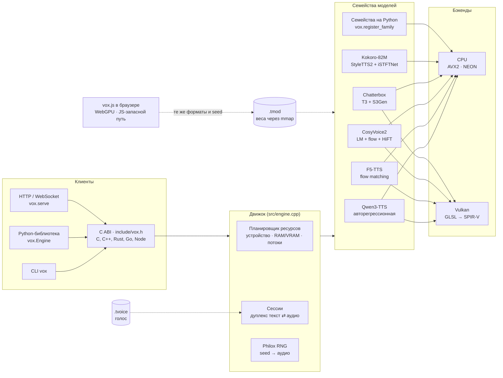

## Модели

| Модель | Голос | Языки | CPU | Vulkan | Браузер | Как сессия принимает текст |
|---|---|---|:-:|:-:|:-:|---|
| **Qwen3-TTS Base** 0.6B / 1.7B | клон по записи и её тексту | 10 (zh, en, ru, ja, ko, de, fr, …) | ✅ | ✅ | ✅ | по словам |
| **Qwen3-TTS CustomVoice** | готовые дикторы, инструкция о стиле (1.7B) | те же | ✅ | ✅ | ✅ | по словам |
| **Qwen3-TTS VoiceDesign** | голос по текстовому описанию | те же | ✅ | ✅ | ✅ | по словам |
| **F5-TTS** v1 / v0 и дообучения | клон по записи и её тексту | зависят от чекпойнта (база en/zh, русские дообучения) | ✅ | ✅ весь граф | ✅ | по предложениям |
| **Kokoro-82M** *(новое в 0.14)* | именные голоса из `voices/*.pt` и смеси `af_heart,bf_emma` | английский со встроенным G2P | ✅ | — | — | по предложениям / строкам |
| **CosyVoice2-0.5B** *(новое в 0.16)* | клон по записи (с её текстом — zero-shot, без — cross-lingual), инструкции и эмоции (instruct2) | zh, en, ja, ko, yue (как обучена) | ✅ | ✅ LLM + эстиматор flow *(0.18)* | — | группами предложений |
| **Chatterbox** (английский) *(новое в 0.17)* | клон по записи без её текста; встроенный голос; эмоции через «exaggeration» | en | ✅ | ✅ T3 + эстиматор flow *(0.18)* | — | группами предложений |

В очереди: XTTS, Chatterbox Multilingual / Turbo. Семейство описывает себя само (`vox inspect`, `engine.capabilities`), а нарезку,
кроссфейды и политику коммита берёт на себя движок.

## Быстрый старт

Из PyPI ([`vox-tts`](https://pypi.org/project/vox-tts/); колёса для Linux x86_64 / aarch64, Windows x64 и macOS arm64):

    pip install vox-tts
    python -m vox serve               # CLI Python-пакета; API — `import vox`

В колёсах для Linux и Windows есть Vulkan-бэкенд. Он открывает загрузчик Vulkan во время работы, поэтому то же колесо работает и на машине без
драйвера GPU (только CPU); колесо для macOS — только CPU. Для другой платформы или сборки под свой процессор — из исходников (pip соберёт сам, если колеса нет;
`pip install --no-binary vox-tts vox-tts` включает её принудительно; нужны CMake и компилятор C++17, для GPU-бэкенда ещё заголовки Vulkan):

    cmake -S . -B build -DVOX_NATIVE=ON && cmake --build build -j
    pip install .                     # Python-модуль (nanobind, scikit-build-core, numpy)

Vulkan включается сам, если найдены заголовки (`libvulkan-dev`). SPIR-V шейдеры лежат в репозитории (`src/vk_shaders.inc`), glslang нужен только
при их изменении (`python tools/gen_shaders.py`). Termux: `pkg install clang cmake python python-numpy`, дальше так же (сборка под aarch64 проверяется в qemu).

<details>
<summary><b>Qwen3-TTS</b>: конвертация, клон голоса, синтез</summary>

    # 1. модель Hugging Face → .tmod (q8 самый быстрый на CPU; bf16 без квантования)
    python -m vox build --model ./Qwen3-TTS-12Hz-1.7B-Base --dtype bf16 --quant q8 -o model.q8.tmod

    # 2. голос по записи, нативно, без torch (лучше WAV 24 кГц, 5–15 с чистой речи)
    vox voice create ref.wav --model model.q8.tmod --text "Текст, который звучит в записи" \
        --name my_voice --lang russian --seed 42 -o voices/my_voice.tvoice

    # 3. синтез
    vox say "Привет! Это проверка." --model model.q8.tmod --voice voices/my_voice.tvoice -o out.wav
    vox say --stdin --stream --model model.q8.tmod --voice voices/my_voice.tvoice | ffplay -f f32le -ar 24000 -i -

    # 4. сервер (стриминг WAV/PCM, создание голоса через POST /v1/voices)
    python -m vox serve --model model.q8.tmod --voices ./voices --port 8080 --device vulkan

</details>

<details open>
<summary><b>Kokoro-82M</b>: конвертация, выбор голоса, синтез</summary>

    pip install misaki                      # необязательно: его словари встраиваются в .tmod для встроенного G2P
    python -m vox.build_kokoro --model ./Kokoro-82M --dtype bf16 -o kokoro.tmod     # config.json, kokoro-v1_0.pth, voices/*.pt
    vox say "Hello! This is Kokoro running in vox." --model kokoro.tmod --speaker af_heart -o out.wav
    vox voice speaker --model kokoro.tmod --speaker "af_heart,bm_george" -o blend.tvoice        # смесь двух голосов
    vox phonemize --model kokoro.tmod "It's 10 o'clock, Dr. Smith."                             # проверить G2P

</details>

<details>
<summary><b>CosyVoice2-0.5B</b>: конвертация, клон, инструкции</summary>

    pip install torch pyyaml onnx onnxruntime s3tokenizer   # нужно только конвертеру
    python -m vox.build_cosyvoice --model ./CosyVoice2-0.5B -o cosyvoice2.tmod      # LLM в bf16, flow и HiFT в f32
    vox voice create ref.wav --model cosyvoice2.tmod --text "Текст, который звучит в ref.wav" -o me.tvoice
    vox say "Привет! [смех] Это CosyVoice2 в vox." --model cosyvoice2.tmod --voice me.tvoice -o out.wav
    vox say "[радостно] Какой хороший день!" --model cosyvoice2.tmod --voice me.tvoice -o happy.wav   # эмоция → instruct2
    vox phonemize --model cosyvoice2.tmod "It costs 25 dollars."                                     # на какие куски разрежет

</details>

<details>
<summary><b>Chatterbox</b>: конвертация, встроенный голос, клон, exaggeration</summary>

    pip install torch safetensors   # только для конвертера
    python -m vox.build_chatterbox --model ./chatterbox -o chatterbox.tmod      # T3 в bf16 (--quant q8 — 8 бит), S3Gen в f32
    vox say "Hello from Chatterbox in vox." --model chatterbox.tmod --speaker default -o out.wav
    vox voice create ref.wav --model chatterbox.tmod -o me.tvoice                    # текст записи не нужен
    vox say "[excited] We won!" --model chatterbox.tmod --voice me.tvoice -o won.wav  # эмоция → exaggeration / cfg_weight
    vox say "Calm down." --model chatterbox.tmod --voice me.tvoice --extra '{"exaggeration":0.3,"cfg_weight":0.5}' -o calm.wav

</details>

<details>
<summary><b>F5-TTS</b>: конвертация, клон, синтез</summary>

    python -m vox.build_f5 --ckpt F5TTS_v1_Base/model_1250000.safetensors --vocab F5TTS_v1_Base/vocab.txt \
        --vocos vocos-mel-24khz/ -o f5.tmod                  # DiT в f16 (с 0.18); --quant q8 [--keep-f32 adaln] — 8 бит
    vox voice create ref.wav --model f5.tmod --text "Текст, который сказан в ref.wav" -o me.tvoice
    vox say "Текст для озвучки" --model f5.tmod --voice me.tvoice --device vulkan -o out.wav [--nfe 32 --cfg 2 --sway -1 --speed 1]

</details>

Python:

```python
import vox
eng = vox.Engine("model.q8.tmod", device="vulkan:0")
voice = eng.clone_voice("ref.wav", "Текст референса", name="my_voice", seed=42)
voice.save("my_voice.tvoice")
audio = eng.synthesize("Привет!", voice)                 # numpy float32, 24 кГц
with eng.session(voice, seed=42) as s:                    # текст кусками → аудио по готовности
    s.feed("Первая фраза. "); chunks = list(s.ready())
    s.end(); chunks += list(s)

k = vox.Engine("kokoro.tmod")
audio = k.synthesize("Hello there!", k.speaker_voice("af_heart"), speed=1.1)
k.phonemize("Hello there!")        # {'phonemes': …, 'chunks': […], 'g2p': 'misaki' | 'builtin'}
```

## Производительность

Замер пользователя на vox 0.14.0: `tools/run_full_check.py` на CPU с 16 потоками и RTX 3050 6 ГБ, Qwen3-TTS 1.7B-Base, около 13 с речи.
qwentts.cpp (Q8_0) запускался на той же машине с тем же текстом. WER и CER — 0 у всех девяти вариантов vox и у обоих прогонов qwentts.cpp.

<p align="center">
  <picture>
    <source media="(prefers-color-scheme: dark)" srcset="docs/img/qwen-rtf-dark.ru.svg">
    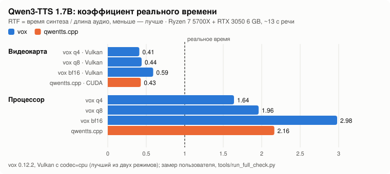
  </picture>
</p>

<p align="center">
  <picture>
    <source media="(prefers-color-scheme: dark)" srcset="docs/img/qwen-memory-dark.ru.svg">
    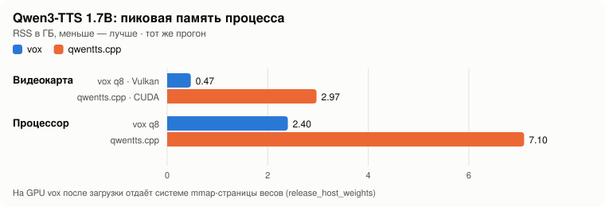
  </picture>
</p>

<details>
<summary>Таблица всех измеренных конфигураций (тёплый RTF / первый чанк / пиковый RSS)</summary>

| Формат | CPU | Vulkan | Vulkan, `codec=cpu` |
|---|---|---|---|
| bf16 | 2,61 / 2133 мс / 3,7 ГБ | 0,62 / 508 мс / 0,47 ГБ | 0,59 / 565 мс / 0,93 ГБ |
| q8 | 1,65 / 2339 мс / 2,4 ГБ | 0,47 / 490 мс / 0,48 ГБ | 0,44 / 563 мс / 0,91 ГБ |
| q4 | 1,35 / 1913 мс / 1,7 ГБ | 0,44 / 481 мс / 0,46 ГБ | 0,42 / 546 мс / 0,90 ГБ |

qwentts.cpp: CUDA 0,426 (2,97 ГБ), CPU 1,84 (7,1 ГБ). Итого vox q8 на CPU примерно на 10% быстрее qwentts.cpp при памяти в 2,9 раза меньше,
а на GPU примерно на 10% медленнее при памяти в 6 раз меньше. q4 не проходит штатный допуск (KL ≤ 0,02, top-5 ≥ 97%), поэтому по умолчанию q8.
На GPU около 70% времени уходит на матрично-векторные умножения talker'а и predictor'а. У predictor'а 160 тысяч мелких вызовов по 33–50 мкс,
поэтому следующее ускорение Qwen3 на GPU — там.
</details>

F5-TTS на настоящих весах (`hotstone228/F5-TTS-Russian`), фраза 2,3 с. С 0.13 весь шаг DiT и Vocos считаются на GPU:

<p align="center">
  <picture>
    <source media="(prefers-color-scheme: dark)" srcset="docs/img/f5-speed-dark.ru.svg">
    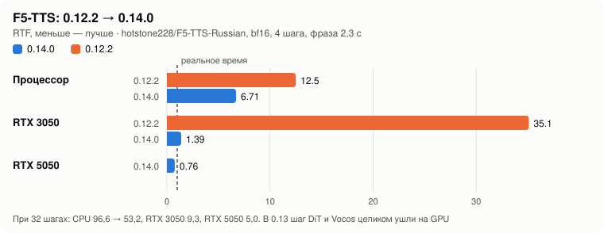
  </picture>
</p>

Kokoro-82M на настоящих весах, на процессоре:

<p align="center">
  <picture>
    <source media="(prefers-color-scheme: dark)" srcset="docs/img/kokoro-cpu-dark.ru.svg">
    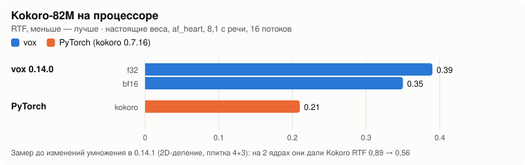
  </picture>
</p>

В 0.14.1 ускорено любое умножение на CPU с многими строками входа. Каждый выход считается в том же порядке суммирования, что и раньше, поэтому звук совпадает бит в бит.
На 2-ядерной машине разработки это дало Kokoro RTF 0,89 → 0,56, а F5 — 0,52 → 0,35 (f32) и 0,42 (bf16). Ваши цифры даст новый прогон.

**CosyVoice2-0.5B** (0.16, только CPU) замерена с настоящими размерами и случайными весами (`tools/make_tiny_cosyvoice.py --full`) на той же 2-ядерной машине.
LLM тратит 96 мс на речевой токен в bf16 и 59 мс с `--quant q8` (на секунду речи нужно 25 токенов, то есть одна LLM даёт RTF 2,4 / 1,5).
Основная нагрузка — flow: в его эстиматоре 56 трансформерных и 14 остаточных блоков, и он проходит 10 шагов × 2 (classifier-free guidance) по кадрам подсказки
и новым кадрам вместе — 16 с на 2,4 с речи при подсказке 2,3 с (≈ 1 ТФЛОП на 4 с речи). HiFT добавляет ~0,6 с на секунду звука. Всего RTF ≈ 7–10 на 2 ядрах;
настольный процессор на 8–16 ядер будет в разы быстрее, но этой модели по-настоящему нужна видеокарта, а на GPU vox её пока не запускает.
О качестве эти цифры ничего не говорят: веса были случайные.

**Chatterbox** (0.17, только CPU) замерен так же (`tools/make_tiny_chatterbox.py --full`, 2 ядра, 60 речевых токенов = 2,4 с, встроенная подсказка 3,2 с):
T3 (Llama на 30 слоёв, два прохода на токен для classifier-free guidance, считаются одним пакетом) — 15,1 с в bf16 и 9,3 с с `--quant q8` вместе с prefill,
то есть около 250 / 150 мс на токен; flow из S3Gen (те же сети, что у CosyVoice2) — 23,7 с, HiFT — 1,8 с. Всего RTF ≈ 15–17 на 2 ядрах, пик памяти 1,8 ГБ (1,4 ГБ с q8).

**На GPU (0.18)**: у CosyVoice2 и Chatterbox эстиматор flow — условный и безусловный проходы одного шага Эйлера — идёт одной отправкой Vulkan
(`gpu_f5.cpp`: ядра F5 плюс причинная свёртка и Mish), а LM по токенам (Qwen2 у CosyVoice2, T3 у Chatterbox с обоими проходами CFG) считает
GPU-трансформер Qwen3-TTS с KV-кэшем в видеопамяти. Энкодер flow и HiFT остаются на CPU (они идут раз на кусок). Сверено на lavapipe с CPU
и официальным кодом (с теми же допусками, что на CPU); **скорость на настоящей видеокарте ещё не замерялась**. `--device cpu` оставляет всё на CPU;
в статистике `vox bench` видно `flow_device`, `llm_device` / `t3_device` и какой GEMM выбран.

## Как работает каждая модель

<details open>
<summary><b>Qwen3-TTS</b>: авторегрессионный talker → code predictor → потоковый декодер кодека</summary>

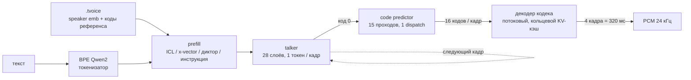

- **Весь пайплайн нативно**: создание голоса (мел-спектр, ECAPA-TDNN, энкодер Mimi с RVQ), talker, code predictor, потоковый декодер
  кодека. torch нужен только для эталонных проверок.
- **На GPU** talker и predictor целиком. Цикл predictor'а (15 проходов на кадр) — один dispatch с сэмплингом в шейдере, 2 синхронизации с хостом
  на кадр. Декодер кодека тоже целиком на GPU, один command buffer на чанк. `codec=cpu` уносит декодер на CPU параллельно с GPU.
- **Модели**: `tts_model_type` читается из чекпойнта. Base — клонирование; CustomVoice — диктор как строка `codec_embedding` (1.7B — ещё и с инструкцией);
  VoiceDesign — голос по описанию.

      vox voice speaker --model custom.tmod --speaker aiden --instruct "Speak slowly" -o aiden.tvoice
      vox say "Hello" --model design.tmod --instruct "A deep calm male voice" -o out.wav

- **Режимы декодера**: `--decoder stream` (по умолчанию) — непрерывное декодирование с прогревом последними 50 кадрами референса;
  `--decoder reference` — бит в бит схема `chunked_decode` из `qwen_tts` (куски по 300 кадров, 25 кадров контекста) для проверок и A/B-сравнений.
</details>

<details>
<summary><b>F5-TTS</b>: текст → DiT flow matching (NFE шагов, CFG) → Vocos</summary>

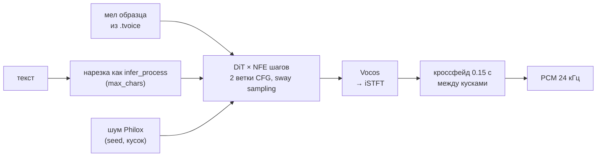

- **Шаг DiT — один command buffer на GPU** (с 0.13): входная проекция, свёрточный позиционный эмбеддинг, все блоки (AdaLN, q/k/v, RoPE,
  flash attention, FFN) и выход; Vocos тоже на GPU, на CPU только iSTFT. `VOX_F5_GPU=0` — старый путь.
- **Конфиг v0 / v1** (`F5TTS_Base` и дообучения вроде `hotstone228/F5-TTS-Russian`): `--model-cfg v0|v1`, конвертер угадывает по пути,
  неверный конфиг даёт шум. Модели, сконвертированные 0.12.1 и старше, пересоберите (CRLF в `vocab.txt`, паддинг Vocos).
- **Vocos остаётся в f32** с 0.14.1 (`--vocos-dtype`, +26 МБ): он маленький, но превращает мел в фазу, и bf16-веса в нём добавляли ошибку волны
  поверх ошибки DiT. `--dtype` и `--quant` относятся к DiT. Чтобы получить это, пересоберите модель.
- **Ядра GPU в 0.14.1**: линейные слои с многими строками считает GEMM с регистровыми плитками (`gemmb.comp`: плитка 128×128, 8×8 выходов на поток,
  64 FMA на 4 чтения vec4 из shared-памяти). Внимание читает K и V как vec4. На настоящих картах ни один GEMM не выигрывает везде: после правки 0.17.1
  `gemmb` на RTX 5050 быстрее на 12–14 %, на RTX 3050 медленнее на 30–35 %. **С 0.18 vox замеряет оба** на слоях самой модели, когда граф впервые
  собирается на устройстве, и до конца процесса берёт быстрый (`VOX_VERBOSE=1` печатает замер; программный рендерер оставляет convgemm).
  `VOX_F5_GEMM=old` / `new` задаёт его явно, `auto` замеряет даже на lavapipe. Оба проверены на lavapipe (звук совпадает с CPU до 4e-9).
  `VOX_PROFILE=gpu` показывает долю каждого шейдера.
- **Точность DiT**: с 0.18 по умолчанию `--dtype f16` (размер как у bf16, округление весов в 8 раз меньше; активации в любом случае f32).
  `--keep-f32 adaln,io,edges` оставляет группы матриц в f32 при любых `--dtype` / `--quant` (модуляция AdaLN и MLP времени, входная / выходная проекции,
  первые и последние два блока). Какие из них важны на настоящих весах, пока неизвестно: `tools/f5_precision.py` собирает варианты и сравнивает их
  с f32 на одних и тех же зёрнах (волна, лог-спектр, по желанию whisper).
- Параметры названы как в официальном коде: `nfe_step`, `cfg_strength`, `sway_sampling_coef`, `speed`, `cross_fade_duration`, `target_rms`,
  `use_epss`, `max_chars` — через `--extra` / `extra={...}`, короткие флаги CLI `--nfe --cfg --sway --speed`.
- Отличия от официального пайплайна: китайский переводится в пиньинь посимвольно, без словаря слов; нет обрезки тишины образца (берутся первые 12 с);
  `fix_duration` не поддерживается.
</details>

<details open>
<summary><b>Kokoro-82M</b> <i>(новое в 0.14)</i>: G2P → PL-BERT → просодия → iSTFTNet</summary>

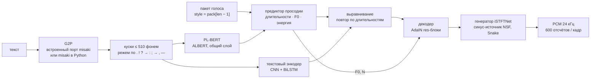

- **Конвертация**: `python -m vox.build_kokoro --model DIR` читает `config.json`, чекпойнт `.pth` (weight norm сворачивается) и `voices/*.pt`.
  Все голоса попадают в `.tmod` как `voice.<имя>`. Если установлен `misaki` (или `--lexicons DIR` указывает на его данные), встраиваются и его
  американские и британские словари gold/silver. Остальные опции: `--dtype f32|f16|bf16`, `--no-g2p`.
- **Голоса**: `--speaker af_heart` или смесь `af_heart,bf_emma` (пакеты усредняются, как в `KPipeline`). Сервер показывает их в
  `GET /v1/voices` и принимает по имени. Британское произношение — если имя голоса начинается с `b` или задан `lang=en-gb`.
- **G2P**:
  - **Встроенный**: порт `misaki.en` на C++ — словари, правила ударения, основы `-s`/`-ed`/`-ing`, числа, валюты, время и разметка
    `[слово](/фонемы/)`, без spaCy и espeak. На `tests/data/g2p_en.txt` совпадает с misaki (без espeak) в 35 из 40 предложений и в 92.1% слов (US и GB).
    Вместо spaCy — эвристический POS-теггер; слова вне словаря раскладываются на словарные или произносятся по буквам.
  - **`misaki` в Python**: если он установлен, `vox.Engine` по умолчанию берёт его для Kokoro (`g2p="misaki"`, с запасным espeak, если он есть) — тогда куски
    в точности те, что дал бы `KPipeline`. Выбор явно: `g2p="builtin" | "misaki"`.
  - **Готовые фонемы**: `extra={"phonemes": true}` (или `--extra '{"phonemes":true}'`) обходит G2P.
- **Параметры** (`--extra` или именованные аргументы в Python): `speed`, `phonemes`, `lang` (`en-us` / `en-gb`; другие языки встроенный G2P отклоняет),
  `noise_file` (для проверок).
- **API**: `vox phonemize --model M [--lang en-gb] "текст"`, `vox_engine_phonemize()` в C ABI, `Engine.phonemize()` в Python.
- Каждый кусок синтезируется целиком, поэтому аудио выходит по кускам (строки, затем куски до 510 фонем).
</details>

<details open>
<summary><b>CosyVoice2-0.5B</b> <i>(новое в 0.16)</i>: Qwen2 LM по речевым токенам → flow matching → HiFT</summary>

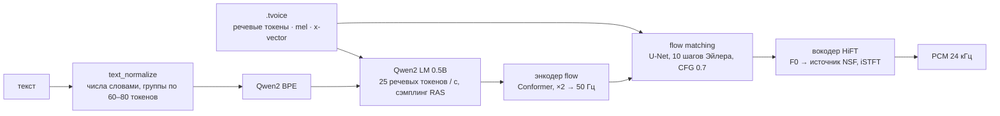

- **Конвертация**: `python -m vox.build_cosyvoice --model DIR` (или `python -m vox build --model DIR`) читает папку релиза
  (`cosyvoice2.yaml`, `llm.pt`, `flow.pt`, `hift.pt`, `campplus.onnx`, `speech_tokenizer_v2.onnx`, `CosyVoice-BlankEN/`).
  LLM хранится в `--dtype` (по умолчанию bf16; `--quant q8` — её линейные слои в 8 битах), flow и HiFT — в `--flow-dtype` (f32). Фиксированный шум flow matching
  (`CausalConditionalCFM` берёт его с зерном 0) тоже сохраняется, поэтому flow детерминирован, как в оригинале.
  Энкодер диктора CAM++ читается из `campplus.onnx` по узлам графа (пары Conv + BatchNorm, которые экспортёр склеил, так и остаются склеенными)
  и при конвертации сверяется с onnxruntime; токенизатор речи идёт через `s3tokenizer.utils.onnx2torch`. `--no-clone` их не берёт.
  CAM++ усредняет контекст по сегментам из 100 кадров; последний, неполный, делится на 100 (`--campplus-pool window`, по умолчанию) — так
  `campplus.onnx` считает onnxruntime до 1.25 включительно (официальный CosyVoice закрепляет 1.18). Новые onnxruntime делят на число кадров в сегменте
  (`count`, так же делает PyTorch); `--campplus-pool auto` следует установленному. В 0.16.0–0.17.0 был `count`, и конвертер отказывался работать
  с настоящей моделью; **`.tmod` CosyVoice2 пересоберите в 0.17.1**.
- **Голос клонируется нативно**, как это делает `CosyVoiceFrontEnd`: запись (до 30 с) передискретизируется алгоритмом torchaudio, затем
  считаются mel 24 кГц (подсказка для flow), x-vector CAM++ по Kaldi fbank на 16 кГц и речевые токены S3 (S3TokenizerV2: log-mel Whisper, энкодер
  из свёрток и внимания с FSMN, FSQ). С текстом записи голос **zero-shot** (LLM подсказывают текст и речевые токены), без него
  (`--xvector-only` или запись профиля без текста) — **cross-lingual** (подсказка только для flow).
- **Инструкции** (`instruct2`): стиль с `--instruct "…"` или тег эмоции (`[happy]`, `[радостно]`), если в профиле нет стиля с таким именем.
  В `.tmod` лежат формулировки эмоций самой модели (китайские фразы, на которых учили CosyVoice2), `<|endofprompt|>` добавляется.
- **Теги**: `[laugh]` превращается в токен модели `[laughter]`; `[breath]`, `[cough]`, `[sigh]` — её собственные. Другие токены модели
  (`[noise]`, `<strong>…</strong>`, `<laughter>…</laughter>`) можно писать в тексте как есть.
- **Текст**: `text_normalize` без ttsfrd / wetext — китайские правила пунктуации и скобок, в остальном тексте числа словами по правилам inflect,
  предложения собираются в группы по 60–80 токенов (`vox phonemize` показывает куски). Текст с `<|…|>` передаётся как есть. Каждый кусок проходит
  LLM → flow → HiFT целиком (`stream=False` оригинала); куски идут друг за другом без кроссфейда.
- **Параметры**: `speed` (mel растягивается, как в `token2wav`), зерно. LLM сэмплирует по официальным правилам RAS
  (top-p 0.8, top-k 25, окно 10 против повторов, конец речи не раньше 2 токенов на токен текста) на Philox: одно зерно — один и тот же звук,
  но не те же токены, что дал бы генератор PyTorch.
</details>

<details open>
<summary><b>Chatterbox</b> <i>(новое в 0.17)</i>: T3 (Llama по речевым токенам, CFG) → S3Gen (flow matching + HiFT)</summary>

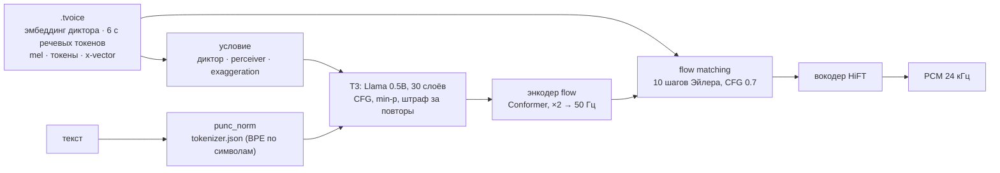

- **Конвертация**: `python -m vox.build_chatterbox --model DIR` (или `python -m vox build --model DIR`) читает `t3_cfg.safetensors`, `s3gen.safetensors`,
  `ve.safetensors`, `tokenizer.json` и `conds.pt` (встроенный голос, он называется `default`). T3 хранится в `--dtype` (bf16), его линейные слои с `--quant q8` —
  в 8 битах; S3Gen остаётся в f32. Размеры S3Gen читаются из весов, batch norm в CAM++ сворачиваются в масштаб и сдвиг.
- **T3** — английская модель ChatterboxTTS: строки условия (эмбеддинг VoiceEncoder через проекцию, perceiver по ≤ 150 речевым токенам подсказки,
  `exaggeration` × выученный вектор), текст с выученными позициями, две строки начала речи; дальше по токену с classifier-free guidance (в безусловном
  проходе эмбеддинги текста обнулены), штраф за повторы → температура → min-p → top-p → выбор на Philox.
- **S3Gen** — flow и HiFT из CosyVoice2 без LLM, с тремя отличиями Chatterbox: начальный шум тянется на каждую фразу, шаги Эйлера берут
  `dt = t[i+1] − t[i]`, источник HiFT — первый SineGen. Первые 40 мс каждого куска получают официальное плавное нарастание.
- **Голоса** клонируются по записи без её текста, как в `prepare_conditionals`: 24 кГц (первые 10 с) → mel, речевые токены и x-vector CAM++ для S3Gen;
  16 кГц → эмбеддинг VoiceEncoder (LSTM по окнам 1,6 с) и 6-секундная речевая подсказка T3.
- **Эмоции**: манифест сопоставляет тегам эмоций движка настройки Chatterbox (`[радостно]` → exaggeration 0.8, cfg_weight 0.3; `[спокойно]` → 0.3 …).
  Опции: `exaggeration`, `cfg_weight` (0 — один проход без guidance; официальный код так не умеет), `temperature`, `repetition_penalty`, `min_p`, `top_p`,
  `max_new_tokens` (1000), `max_chars` (300: текст режется на группы предложений такой длины; официальный код читает его целиком).
- **Без водяного знака**: официальный `ChatterboxTTS` помечает всё, что говорит, водяным знаком Perth от Resemble. vox этого не делает.

</details>

## Профили голосов: несколько голосов, эмоции, любые модели

*Новое в 0.15.* `.tvoice` теперь **профиль**: в одном файле несколько голосов. У каждого голоса есть стили (эмоции, подача), записи, с
которых его клонировали, готовые дикторы для моделей без клонирования и кэш голоса, уже собранного под каждую модель, на которой он звучал.

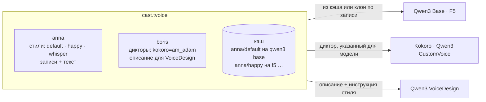

    vox profile new cast.tvoice --name "Cast"
    vox profile add cast.tvoice --voice anna anna.wav --text "Что Анна говорит в записи"
    vox profile add cast.tvoice --voice anna --style happy anna_happy.wav --text "Что-то радостное"
    vox profile set cast.tvoice --voice anna --style whisper --instruct "Whisper softly" --speed 0.95
    vox profile add cast.tvoice --voice boris --from boris.tvoice          # голос из другого файла (любой модели)
    vox profile set cast.tvoice --voice boris --speaker "kokoro=am_adam;qwen3-tts/custom_voice=ryan"
    vox profile show cast.tvoice
    vox profile prepare cast.tvoice --model f5.tmod                        # собрать все голоса под модель сразу и сохранить в файл
    vox say "anna: Привет! [happy] Отличные новости.
    boris: [whisper] Правда? [pause 400ms] Рассказывай." --model f5.tmod --voice cast.tvoice -o dialogue.wav

```python
p = vox.Profile("Cast")
p.add_recording("anna", "anna.wav", "Что Анна говорит в записи")
p.add_recording("anna", "anna_happy.wav", "Что-то радостное", style="happy")
p.set_style("anna", "whisper", instruct="Whisper softly", speed=0.95)
p.set_voice("boris", speakers={"kokoro": "am_adam"})
p.save("cast.tvoice")
audio = engine.synthesize("Привет.", p, voice_id="anna", style="happy")
audio = engine.synthesize("anna: Привет! [pause 300ms]\nboris: [laugh] Здравствуй.", p)     # разметка
```

**Один профиль на любой модели.** Если модели нужен голос, которого в профиле под неё ещё нет, движок собирает его при первом использовании,
а `save()` / `vox profile prepare` сохраняют результат:

| модель | из чего собирается голос |
|---|---|
| Qwen3 Base, F5-TTS (клон по записи) | запись стиля и её текст (запись стиля по умолчанию, если у стиля своей нет) |
| Kokoro, Qwen3 CustomVoice (готовые дикторы) | `speakers` голоса: `kokoro`, `qwen3-tts/custom_voice` (семейство или семейство/вариант); CustomVoice 1.7B получает ещё инструкцию стиля |
| Qwen3 VoiceDesign (голос по описанию) | описание голоса плюс инструкция стиля |

Если голос на модели собрать нельзя (например, для Kokoro не указан диктор), будет понятная ошибка с тем, что добавить.

**Разметка в тексте** (`markup`: по умолчанию `auto`, ещё `strict`, `off`):

| разметка | что значит | если модель так не умеет |
|---|---|---|
| `[voice:anna]`, `[anna]`, `anna: …` в начале строки | сменить голос (реплики — в профилях с двумя и больше голосами) | — |
| `[happy]`, `[style:happy]`, `[радостно]` | стиль голоса; эмоция без своего стиля переводится для модели | инструкция (Qwen CustomVoice 1.7B, VoiceDesign), иначе темп (F5, Kokoro), иначе заметка |
| `[/]`, `[neutral]` | вернуть стиль и темп по умолчанию | — |
| `[pause 500ms]`, `[pause 1.5s]`, `[break]`, `[пауза 300мс]` | тишина точной длины | — |
| `[speed 1.2]` | темп речи | заметка (у Qwen3 темпа нет) |
| `[laugh]`, `[sigh]`, `[cough]`, `[смех]` … | невербальный звук | собственный тег модели, если он есть, иначе короткая пауза |
| `\[` | обычная скобка | — |

В `auto` скобка, которая ничем из этого не является, остаётся текстом; в `strict` удаляется, а с `off` всё читается как текст. Текст вокруг
тегов звучит ровно так, как если бы каждый кусок произнесли отдельно. Что движок не смог сделать как просили, перечислено в `notes` сессии
(`session.info["notes"]`). Тег может прийти разрезанным между вызовами `feed()`.

**Совместимость.** `.tvoice` 1.0 открывается как профиль с одним голосом и звучит бит в бит как раньше. Профиль, у голоса по умолчанию
которого есть сборка, сохраняется в формате **1.1**: на верхнем уровне в нём этот голос в раскладке 1.0, поэтому vox 0.14 и vox.js читают его
как обычный голос. Профиль совсем без сборок — формат 2.0, старые версии отказываются от него с понятным сообщением. Записи хранятся в
профиле один раз, как WAV.

## Vox Studio: движок из браузера

*Новое в 0.15.* `vox web` (или `vox -web`) запускает движок со встроенным сервером и печатает ссылки с секретом. Откройте страницу
**Vox Studio**, и движком можно управлять из браузера:
- сценарий с несколькими голосами и разметкой, звук играет по мере синтеза;
- профили голосов: запись с микрофона, стили, готовые дикторы для разных моделей;
- модели и устройства;
- история всего озвученного.

*0.19*: новый интерфейс — боковая панель, дубли с крупной волной в цвете голоса («Ещё вариант» с новым seed, «В редактор»), кто говорит — значки
голосов над редактором, меню эмоций, параметры сгруппированы и коротко объяснены (на узком экране — выезжающая панель), карточки моделей
с «Подобрать под этот компьютер» (`vox tune`), поиск по истории, светлая и тёмная темы; профили с одинаковыми именами различаются по файлу.

Страница статичная: она живёт на `vox.arkonova.network/studio/`, и её же раздаёт сам движок. Речь делается на вашей машине, а страница
говорит с движком HTTP-запросами — как панель Clash со своим ядром.

    vox web --models ./models --voices ./voices
      Vox Studio:  https://vox.arkonova.network/studio/#url=http%3A%2F%2F127.0.0.1%3A7860&secret=…
      this engine: http://127.0.0.1:7860/studio/#secret=…
    vox web --models ./models --host 0.0.0.0 --tls      # для других компьютеров: https с самоподписанным сертификатом

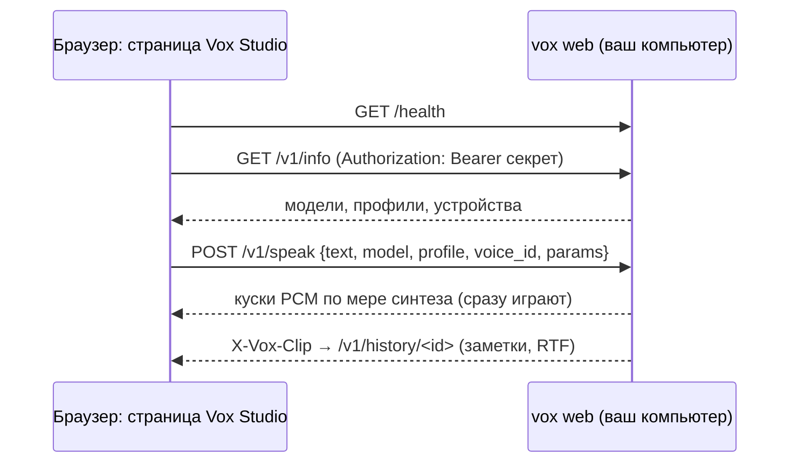

- **Секрет.** Он нужен для каждого запроса к `/v1` (`Authorization: Bearer …` или `?token=` для ссылок на звук и WebSocket). В ссылке секрет
  стоит после `#`, а эту часть браузер никогда не отправляет сайту со страницей. Хранится в `~/.vox/web_secret`; `--new-secret` делает новый.
- **Доступ к движку.** Страница по https может обращаться к `http://127.0.0.1` / `localhost` (Chrome может один раз спросить разрешение на
  доступ к локальной сети). С другого компьютера к обычному http ей нельзя, поэтому есть три способа:
  - `--tls`: самоподписанный сертификат создаётся на имена и адреса машины; откройте `https://…/health` движка один раз и примите его;
  - `--cert` / `--key` со своим сертификатом;
  - Studio, которую раздаёт сам движок (`http://ХОСТ:ПОРТ/studio/`).
- **API** (и для своих клиентов):
  - модели: `/v1/models` (открыть, закрыть, добавить);
  - профили: `/v1/profiles` (создать, PATCH, записи, prepare, скачать и загрузить);
  - синтез: `POST /v1/speak` (потоком pcm16 / f32 / wav);
  - `/v1/history` и WebSocket `/v1/duplex` (протокол `vox serve`).

  Полный список — в начале `python/vox/web.py`.

## Самонастройка: `vox tune`

*Новое в 0.19.* Какое устройство и размещение быстрее, зависит от модели и компьютера (RTX 5050 считает F5 быстрее одним GEMM, RTX 3050 —
другим; небольшая модель на 16 ядрах может обогнать видеокарту ноутбука). `vox tune` не угадывает, а замеряет:

    vox tune --model cosyvoice2.tmod --voice me.tvoice       # модели с готовыми дикторами голос не нужен
      [1/7] vulkan:0 (NVIDIA GeForce RTX 5050)        RTF 0.53, first sound 5393 ms, GEMM convgemm
      [2/7] vulkan:1 (NVIDIA GeForce RTX 3050)        RTF 0.59, first sound 5995 ms, GEMM convgemm
      [3/7] cpu, 8 threads                            stopped: slower than the best so far
      …
    best: vulkan:0 (…); saved to ~/.cache/vox/tune.json
    vox say "…" --model cosyvoice2.tmod --voice me.tvoice    # device auto теперь открывает её на vulkan:0

- **Варианты** (`vox tune --show` их показывает): каждая не программная видеокарта с размещением по умолчанию и с переносом на CPU каждой
  *лёгкой* GPU-стадии (меньше четверти весов на GPU: декодер кодека Qwen3, Vocos у F5); затем CPU — поток на физическое ядро, все логические
  CPU (SMT) и ¾ ядер. Тяжёлые стадии на CPU во всех замерах были в 3–10 раз медленнее, поэтому больше не пробуются (вручную
  `--device vulkan:0,flow=cpu` работает). Видеокарты идут первыми: вариант, чей синтез идёт вдвое дольше синтеза лучшего (+3 с; весь запуск
  ещё ограничен 3× стены лучшего, не меньше 90 с), останавливается, а после первого остановленного CPU-варианта остальные CPU-варианты не
  запускаются. Результаты в пределах 3 % от самого быстрого — ничья: остаётся первый (обычная конфигурация). `--candidates JSON` — свой
  список вариантов.
- **GEMM — не отдельный вариант**: у F5 и моделей с flow каждый вариант на видеокарте при сборке графа сам замеряет convgemm и gemmb на слоях
  модели и берёт быстрый; в строке видно, какой победил (`GEMM gemmb`), и он записывается в результат.
- Каждый вариант идёт в своём дочернем процессе (`vox bench`; Vulkan — одно устройство на процесс), на коротком тексте на языке модели.
  `--goal latency` выбирает самый ранний первый звук вместо наименьшего RTF; `--runs N`, `--text`.
- **Применение**: движок, открытый с ресурсами по умолчанию (`device` auto, без потоков, размещения и слоёв), ищет модель и железо
  (процессор, ядра, RAM, каждую видеокарту и её драйвер) и открывается с замеренной конфигурацией; `vox plan` показывает `tuned: …`.
  Явные настройки важнее, `VOX_TUNE=0` или `{"tuned": false}` отключают. Новая видеокарта, обновление драйвера или пересобранная модель —
  новый ключ.
- Python: `vox.tune(model, voice)` (с отчётом о ходе, тот же кэш), `vox.tune_info(model)`; в Studio у каждой модели есть «Подобрать под этот
  компьютер» (`POST /v1/models/tune`). `vox tune --forget` удаляет результат.

## Ресурсы: устройство, память, режим

    vox devices [--json]                          # CPU, RAM, GPU с индексами и свободной видеопамятью
    vox plan --model m.tmod --mode memory --ram-limit 3GiB --vram-limit 2GiB     # план без загрузки весов
    vox say "…" --model m.tmod --voice v.tvoice --device gpu:1 --mode balanced --threads 6 --affinity 0-5 \
        --priority low --ram-limit 6GiB --vram-limit 3GiB --place codec=cpu --gpu-layers talker=14 --max-sessions 2
    --config resources.json                       # то же JSON-файлом; флаги командной строки его перекрывают

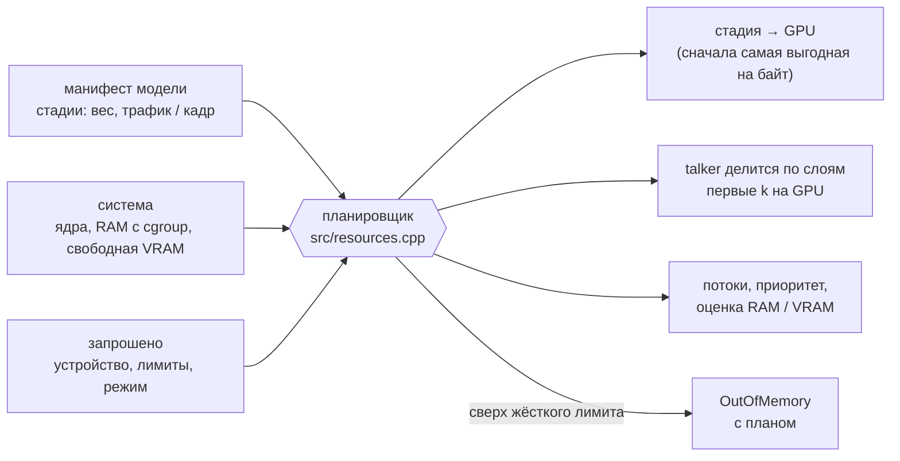

<details>
<summary>Подробнее: режимы, лимиты, устройства</summary>

- **Режимы** считают *физические* ядра (0.19.1: SMT-соседи делят блоки FMA и кэш, и 16 потоков на 8-ядерном Ryzen были на 37 % медленнее
  8): `speed` — поток на ядро с активным ожиданием; `balanced` (по умолчанию) — тоже поток на ядро на CPU с SMT (соседи остаются системе),
  без SMT на ядро меньше; `memory` — половина ядер без активного ожидания; `background` — четверть с низким приоритетом, без GPU.
  `--threads N` задаёт явно (`vox devices` показывает `cpu_physical`).
- **Лимиты жёсткие**: если план больше `ram_limit` / `vram_limit`, модель отклоняется (`OutOfMemory` с планом в тексте), если не задано
  `enforce=false`. Сессия, не влезающая в остаток лимита, не создаётся; `max_sessions` ограничивает их число. После загрузки на GPU
  mmap-страницы весов возвращаются системе (`--no-release` отключает).
- У каждого движка свой пул потоков CPU (привязка к ядрам, `nice`): два движка с разным числом потоков дают одинаковый результат.
- `--device cpu | auto | gpu[:N] | vulkan | vulkan:N`, плюс `,strict` (ошибка, если матрица не влезла) и `,<стадия>=cpu|gpu` для любой стадии
  из `vox plan` (`codec=cpu`, `flow=cpu`, `t3=cpu`, …).
  Нумерация Vulkan не совпадает с nvidia-smi и CUDA — ориентируйтесь на имя из `vox devices`. Программные рендереры (llvmpipe) `auto` не выбирает.
- vox пишет в stderr, что ушло в VRAM и почему; тихого отката нет. Одно Vulkan-устройство на процесс.
- Python: `vox.devices()`, `vox.plan(model, vox.Resources(...))`, `vox.inspect(model)`, `eng.stats()`, `eng.benchmark(...)`;
  ошибки — `vox.VoxError`, `vox.OutOfMemory`, `vox.DeviceError`.
</details>

## Двусторонний стриминг

Текст можно подавать на лету и забирать аудио по готовности, а можно наоборот: печатать текст и получить одну запись.
«Сантехнику» берёт на себя движок: он знает, как модель принимает текст, и решает, что и когда ей отдать.

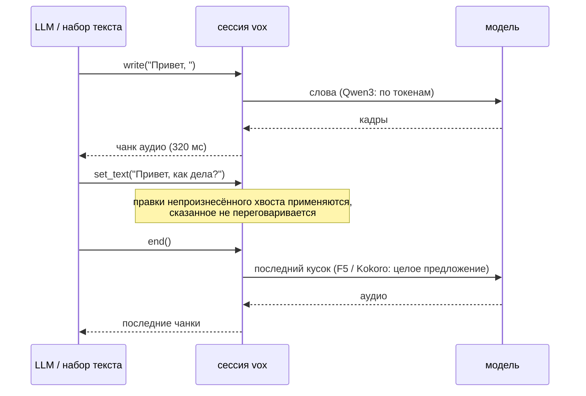

| Модель | как читает текст | что делает движок |
|---|---|---|
| Qwen3-TTS | по словам (`text_in: token`) | отдаёт слова по мере поступления, придерживает недописанное слово |
| F5-TTS, Kokoro | целыми кусками (`text_in: chunk`) | копит текст до конца предложения (или паузы в наборе `idle_ms`); с `auto` результат совпадает с синтезом всего текста сразу |

    with engine.duplex(voice, commit="auto", idle_ms=600) as d:       # Python
        d.write("Привет, "); d.write("как дела?"); d.end()           # из любого потока
        for chunk in d.audio(): play(chunk)                           # aaudio() для asyncio, final() — одна запись
    printf 'Привет. Как дела?' | vox live --model m.tmod --voice v.tvoice -o out.wav --commit sentence
    # HTTP: WebSocket /v1/duplex — {"type":"start"|"text"|"set_text"|"flush"|"end"|"cancel"}, аудио — бинарные кадры PCM

Политика коммита (`commit`): `auto` | `sentence` | `manual` (ничего не уходит до `flush()` / `end()`); конфликт с уже сказанным:
`keep` | `raise` | `respeak`.

## Браузер: vox.js

Один скрипт без зависимостей (`docs/vox.js`, ES-модуль `docs/vox.mjs`), который запускает **F5-TTS и Qwen3-TTS** на WebGPU, а без WebGPU переходит на JS-бэкенд для CPU.

```html
<script src="vox.js"></script>
<script type="module">
  const f5 = await Vox.load("hf:SWivid/F5-TTS", { dtype: "bf16", onProgress: (p) => console.log(p) });
  const voice = await f5.cloneVoice(refFile, "Текст, который сказан в записи");
  const { pcm, sampleRate } = await f5.synthesize("Привет, мир!", { voice, nfe_step: 16, seed: 1 });
  Vox.play(pcm, sampleRate);

  const q = await Vox.load("hf:Qwen/Qwen3-TTS-12Hz-0.6B-CustomVoice", { dtype: "bf16" });
  const v = q.speakerVoice(q.speakers[0], "", { language: "english" });
  for await (const piece of q.stream("Long text.", { voice: v, seed: 1 })) { /* куски аудио */ }
</script>
```

<details>
<summary>Загрузка по ссылке, кэш, нагрузка на GPU, ограничения</summary>

- `Vox.load` принимает репозиторий Hugging Face (`hf:org/name`, ссылку на страницу, `tree`/`resolve`), прямую ссылку, `.tmod`, `File`/`Blob` или набор файлов.
  Чекпойнты конвертируются в браузере теми же преобразованиями, что и конвертеры на Python (для Qwen3 — байт в байт по каждому тензору).
  Qwen3 читается по тензорам через HTTP Range блоками по 8 МиБ, шесть запросов параллельно, сразу в видеопамять; блоки кэшируются в Cache API, повторная загрузка ничего не качает.
- Опции: `dtype`, `quant: "q8"`, `token`, `hfHost`, `backend` (`auto` | `webgpu` | `cpu`), `load` (`balanced` | `gentle` | `full`),
  `cache`, `blockMiB`, `modelCfg` (F5 v0/v1). `Vox.convert(src)` возвращает байты `.tmod`.
- Работа отправляется срезами по ~30 мс с паузами, чтобы ОС, браузер и сторожевой таймер драйвера не страдали (`model.gpu.setLoad(...)`).
- Клонирование голоса Qwen3 Base по записи работает в браузере (`model.cloneVoice(audio, refText)` → `voice.toTvoice()`).
- Тот же `seed` даёт то же аудио, что `vox say --seed`.
- **Не проверено**: настоящие видеокарты и драйверы (тесты идут на SwiftShader), настоящие веса в браузере, Safari и Firefox, настоящий huggingface.co.
- Ограничения: вычисления в f32 (без f16 и cooperative matrix), KV-кэш в f32, у Qwen 16 обращений к видеокарте на кадр, q4 в браузере не собирается,
  запасной путь на CPU — однопоточный JS. Kokoro в браузере пока нет.
</details>

## Что проверено

Каждое семейство собирается крошечным из **официальных классов PyTorch** со случайными весами (те же модули, имена тензоров и поток данных,
что у настоящих чекпойнтов, только узкие) и сравнивается с vox по стадиям. CI гоняет это на CPU и на программном Vulkan (lavapipe).

| Семейство | Эталон | Результат |
|---|---|---|
| Qwen3-TTS | `qwen_tts` 0.1.1 (`generate_voice_clone`, `generate_custom_voice`, `generate_voice_design`) | speaker embedding ≤ 4e-7; коды референса совпадают на 100%; логиты talker / predictor ≤ 1e-6 / 1e-5, argmax 100%; аудио декодера ≤ 3e-4; на **настоящей 1.7B-Base**: логиты ≤ 2.6e-4, argmax 100% |
| F5-TTS | `f5_tts` + `vocos` | токенизатор, мел, текстовый энкодер, DiT (обе ветки CFG), Vocos, цикл CFM ~1e-6; сквозное аудио 3e-9; GPU-граф на lavapipe 4e-9; **настоящий** `hotstone228/F5-TTS-Russian`: мел ~5e-6 (f32), ошибка одна и та же на CPU, RTX 3050 и RTX 5050 |
| CosyVoice2 | репозиторий CosyVoice (`CosyVoice2Model`, `CosyVoiceFrontEnd`), onnxruntime, s3tokenizer | mel 24 кГц 2e-6, fbank 3e-5, x-vector CAM++ 2.5e-7, mel Whisper 2e-5, речевые токены 100%, лог-вероятности LLM 2e-7 при совпадении argmax 100%, mel flow 3e-7, звук HiFT 1.4e-4 (отн.); целые фразы через движок (голос из WAV, официальные токены и шум) — max \|Δ\| 7e-6–1.4e-5 во всех трёх режимах; куски текста совпадают с `text_normalize` на 8 текстах. **настоящая CosyVoice2-0.5B** (0.17.1, проверила автор vox): whisper слышит английский и китайский дословно (bf16 и q8), `[happy]` / `[laugh]` работают; бок о бок с официальным кодом не сравнивалось (его фронтенду нужны ttsfrd / wetext) |
| Chatterbox | `chatterbox-tts` 0.1.7 (`ChatterboxTTS.generate`, `prepare_conditionals`) | токены текста 100% на 8 текстах; VoiceEncoder 7e-7, условие T3 3e-7, логиты T3 с CFG 1e-6 на каждом шаге, mel flow 4e-7, F0 HiFT 5e-7, звук 6e-5 (отн.); целые фразы через движок (встроенный голос, официальные токены и шум, четыре набора опций) — max \|Δ\| 4e-6–1.3e-5; клонированный голос: подсказка S3Gen та же, косинус VoiceEncoder 0.999997. **настоящий ResembleAI/chatterbox** (0.17.1, проверила автор vox): встроенный голос и клон слышны дословно (bf16, q8); RTF на CPU 3,5–4,2 против 4,2 у официального кода на torch |
| Kokoro-82M | `kokoro` 0.7.16 + `misaki` 0.7.4 (`KModel`, `KPipeline`) | каждая стадия (PL-BERT, энкодер длительностей, длительности, F0/N, текстовый энкодер, выравнивание, источник NSF, STFT, генератор) до ~1e-6; во всех сквозных сценариях та же длина, log-mel 0.16–0.71 дБ (2.64 дБ при другом шуме); G2P — 92.1% слов против misaki; **настоящая Kokoro-82M**: длина как у официальной (8,000 с), средний \|Δ log-mel\| 0,125, whisper слышит те же слова |
| vox.js | ядро и официальные дампы | аудио F5 3.7e-9; конвертация Qwen3 байт в байт, аудио = `vox say --seed`; CPU-путь < 1e-4 |
| Привязки | `vox say --seed 42` | C, C++, Rust, Go, Node.js, Python ctypes — бит в бит |

`vox verify` прогоняет коды эталона с teacher forcing и сравнивает логиты каждого шага и аудио декодера; для q8 — средний KL (≤ 0.02) и
top-5 (≥ 97%) вместо argmax.

<details>
<summary>Полный прогон на вашей машине: <code>tools/run_full_check.py</code></summary>

    python tools/run_full_check.py --model-dir ./Qwen3-TTS-12Hz-1.7B-Base --ref-audio ref.wav \
        --ref-text "Текст референса" --lang russian --dtypes bf16,q8 \
        --devices "cpu;vulkan:1,strict;vulkan:1,codec=cpu,strict" --threads 8 \
        --external "qwentts.cpp=./qwentts-cli --model m.gguf --out {out} < {text_file}" \
        --external-time 'qwentts.cpp=\[Perf\] Total:\s*([\d.]+)\s*ms' \
        --wer --asr-cmd 'whisper-cli -m ggml-small.bin -l {lang} -nt -np -f {wav}' --out work/

Прогон конвертирует веса, нативно создаёт голос и сравнивает его с `qwen_tts`, снимает дампы PyTorch, проверяет каждую пару «формат × устройство»,
меряет скорость (холодный и тёплый старт, первый чанк, пиковая память, профили по стадиям и GPU), запускает внешний движок на том же тексте
и с `--wer` оценивает разборчивость через whisper. Результат — `work/report.md`. Профили: `VOX_PROFILE=1` (стадии CPU), `VOX_PROFILE=gpu`
(метки времени GPU по шейдерам), `VOX_PROFILE=f5`, `VOX_PROFILE=kokoro`.

Проверить референс до создания голоса: `python tools/check_reference.py ref.wav --ref-text "..."`. Лишнее слово в начале синтеза почти всегда
означает, что текст референса не совпадает с записью.
</details>

## Форматы

- `.tmod`: заголовок `VOXM`, JSON-манифест (стадии, точность, токенизатор, параметры генерации, голоса), блобы с выравниванием 4096 под mmap.
- `.tvoice`: safetensors. С 0.15 это профиль (метаданные `profile`: голоса, стили, записи, индекс кэша; тензоры `ref.<id>` и `c<N>.*`);
  сборка голоса по умолчанию лежит на верхнем уровне в раскладке 1.0 (`speaker_emb`, `ref_codes`, `ref_text_tokens`, `ref_audio`, метаданные `voice`). Сборка привязана к весам по sha256.
  Голос в режиме `speaker` (готовый диктор, описание, голос Kokoro или смесь) хранит имя диктора и привязан к варианту модели.
- **Q4**: 4 бита на вес, блоки по 32. `--quant q4` — внимание и MLP talker'а, `q4mlp` — только MLP, `q4full` — всё. На RTX 3050 он быстрее и
  занимает на треть меньше VRAM, но допуск KL/top-5 не проходит; WER на пяти фразах 0.12–0.18 против 0.07 у q8, на слух разницы в клонах нет.

## Из других языков

Все привязки идут через C ABI. В `examples/`: C (`minimal.c`), C++ (`minimal.cpp`), Rust (`rust/`), Go (`go/`, cgo), Node.js (`node/`, koffi),
Python ctypes. `tests/test_examples.py` собирает каждую и требует совпадения аудио с `vox say --seed 42` бит в бит.
Модель можно написать целиком на Python и зарегистрировать (`vox.register_family`): см. [docs/python-backends.md](docs/python-backends.md).

## Страница проекта

В `site/` лежат исходники [страницы проекта](https://dariumi.github.io/Vox/index.ru.html) с живым демо на WebGPU; `python tools/build_site.py` собирает её в `docs/`.
Примеры кода на странице вставляются прямо из `examples/`, то есть это те же файлы, что проверяют тесты. Графики строятся по замеренным числам
командой `python tools/make_charts.py`.

## Устройство кода

| путь | что |
|---|---|
| `include/vox.h` | C ABI: движок / голос / сессия, pull-стриминг, отмена, phonemize |
| `src/engine.cpp` | реализация ABI, сэмплинг, чанки, дуплексные сессии, конвейер «GPU генерирует, CPU декодирует» |
| `src/backend_qwen3.cpp`, `src/qwen3.cpp`, `src/qwen3_voice.cpp` | Qwen3-TTS: режимы prefill, talker, predictor, декодер; создание голоса (мел, ECAPA-TDNN, Mimi, RVQ) |
| `src/f5.cpp`, `src/f5_ops.cpp`, `src/backend_f5.cpp`, `src/gpu_f5.cpp` | F5-TTS: токенизатор, DiT + CFM, Vocos, нарезка текста и кроссфейд, граф DiT на Vulkan; эстиматор flow CosyVoice2 / Chatterbox на Vulkan |
| `src/kokoro.cpp`, `src/backend_kokoro.cpp` | Kokoro-82M: PL-BERT, предиктор просодии, текстовый энкодер, декодер, генератор iSTFTNet |
| `src/kokoro_g2p.cpp`, `src/kokoro_g2p_en.cpp` | английский G2P (порт misaki.en) и нарезка на куски как в KPipeline |
| `src/cosyvoice.cpp`, `src/cosyvoice_front.cpp`, `src/backend_cosyvoice.cpp` | CosyVoice2: Qwen2 LM, flow (Conformer + CFM), HiFT; mel / fbank / CAM++ / токенизатор S3; текстовый фронтенд |
| `src/chatterbox.cpp`, `src/backend_chatterbox.cpp`, `src/hf_tokenizer.cpp` | Chatterbox: T3, VoiceEncoder, нарезка на куски; чтение `tokenizer.json` (BPE) |
| `src/nn.cpp` | общие слои свёрточных моделей (свёртки, источник NSF, STFT / iSTFT, внимание, ресэмплер torchaudio) |
| `src/profile.cpp`, `src/markup.cpp` | профили голосов (формат, правка, сборка под разные модели) и разметка текста |
| `src/resources.cpp`, `src/family.cpp`, `src/tune.cpp` | планировщик ресурсов и бюджет сессий; реестр семейств моделей (C++ и Python); кэш и варианты `vox tune` |
| `src/kernels.cpp` | пулы потоков, matmul (f32/f16/bf16, q8 и q4 int8-dot AVX2), трансформер (включая гибрид GPU/CPU) |
| `src/gpu_vulkan.cpp`, `src/gpu_codec.cpp`, `src/shaders/*.comp` | Vulkan: matmul, трансформер, декодер кодека, профайлер; шейдеры GLSL (SPIR-V в `src/vk_shaders.inc`) |
| `webgpu/wgsl/`, `webgpu/web/src/` | WGSL-шейдеры и исходники `vox.js` (`tools/build_web.py`) |
| `python/vox` | Python API, конвертеры `vox.build` / `vox.build_f5` / `vox.build_kokoro` / `vox.build_cosyvoice` / `vox.build_chatterbox`, сервер `vox.serve`, фронтенд misaki |
| `site/`, `docs/` | страница проекта и её сборка для GitHub Pages; в `docs/img/` графики |
| `tools/` | эталоны, полный прогон, крошечные модели (`make_tiny_*.py`), графики |
| `tests/`, `examples/` | модульные и эталонные тесты; клиенты на шести языках |

## Тесты

    tests/run_all.sh          # C++, токенизатор, Qwen3 / F5 / Kokoro против официального кода (если стоят torch и пакеты),
                              # примеры на 6 языках, vox.js в Chromium (если есть playwright), Python, сервер, дуплекс, Q4
    VOX_QWEN2_GGUF=qwen2.gguf VOX_TEST_DEVICES="cpu;vulkan:0" python tests/test_official.py build/vox
    python tests/test_kokoro_tiny.py build/vox
    VOX_COSYVOICE_SRC=CosyVoice VOX_QWEN2_GGUF=qwen2.gguf python tests/test_cosyvoice_tiny.py build/vox   # клон FunAudioLLM/CosyVoice
    python tests/test_chatterbox_tiny.py build/vox                                                        # pip install chatterbox-tts

Словарь для тестов: `curl -L -o qwen2.gguf https://raw.githubusercontent.com/ggml-org/llama.cpp/master/models/ggml-vocab-qwen2.gguf`.
CI (`.github/workflows/ci.yml`) гоняет всё это на CPU и на lavapipe.

## Ограничения

- GPU в нативных сборках — только Vulkan (CUDA и Metal нет); шейдеры общие, без тензорных ядер и cooperative matrix; одно Vulkan-устройство на процесс.
- **Kokoro**: только CPU (ни Vulkan, ни браузера пока нет); встроенный G2P только английский и на части слов расходится с misaki
  (эвристический теггер вместо spaCy, нет espeak). На настоящих весах на 16 потоках примерно в 1,7 раза медленнее PyTorch (замер 0.14.0, до ускорения умножений в 0.14.1).
- F5-TTS при 32 шагах на GPU всё ещё медленнее реального времени (RTF 5 на RTX 5050); графу нужен `dim_head ≤ 64` (так у всех официальных чекпойнтов).
- **CosyVoice2**: на GPU только LLM и эстиматор flow (энкодер, HiFT и фронтенд клонирования — на CPU). В текстовом фронтенде нет ttsfrd / wetext (в китайском тексте числа остаются цифрами — как в официальном коде без них). Звук выходит
  группами предложений, а не по токенам (официальный двусторонний стриминг не реализован). С официальным кодом сверено только на крошечной модели.
- **Chatterbox**: на GPU только T3 и эстиматор flow (энкодер, HiFT, VoiceEncoder — на CPU); только английская модель (не Multilingual и не Turbo). Звук выходит группами предложений. Для подсказки T3 клонированный голос
  переводится в 16 кГц алгоритмом torchaudio, а официальный код — soxr: подсказка S3Gen и эмбеддинг диктора совпадают, часть из 150 токенов подсказки T3
  может отличаться. С официальным кодом сверено только на крошечной модели.
- Основной путь рассчитан на авторегрессионные кодековые модели; не-AR подключаются через режим «direct» `Backend` (так сделаны F5, Kokoro, CosyVoice2 и Chatterbox). XTTS пока не подключён.
- Официальный `non_streaming_mode=True` (весь текст в prefill) не реализован. Python-бэкенд считает на CPU в интерпретаторе — для прототипов.
- Сэмплинг на GPU считает в float, на CPU — в double. Тот же seed на том же устройстве даёт то же аудио.
- Ресемплинг входа для голоса — sinc/Kaiser; бит в бит с `qwen_tts` (soxr) только для WAV 24 кГц.
- NFC-нормализация делается в Python-обёртке; из CLI и C ABI подавайте текст уже в NFC.
- Сборка aarch64 проверяется в qemu; пробы RAM/ядер для macOS и Windows не запускались.

## Лицензия

Apache-2.0 (см. `LICENSE`). `third_party/json.hpp` — nlohmann/json (MIT). Веса моделей распространяются на условиях своих лицензий и в репозиторий не входят.
