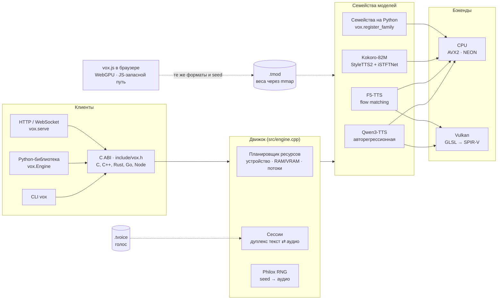
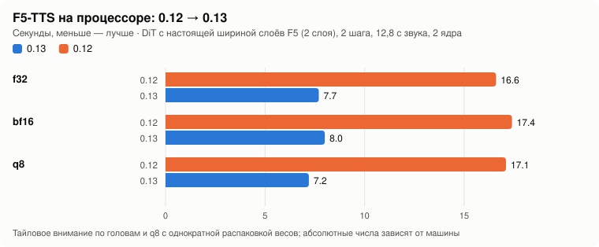
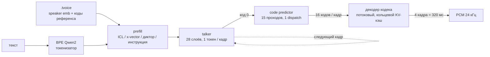
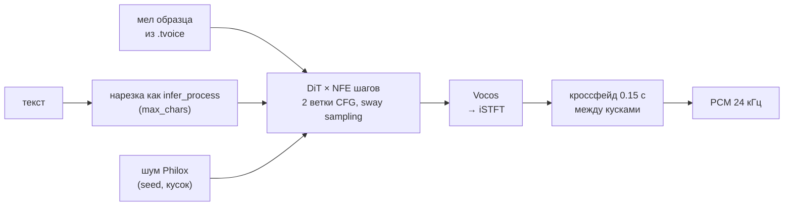
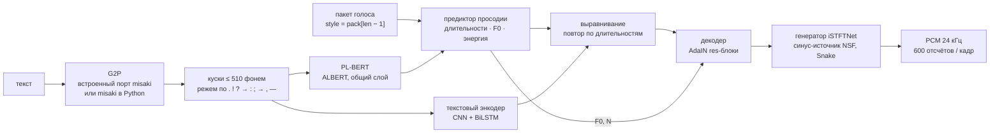
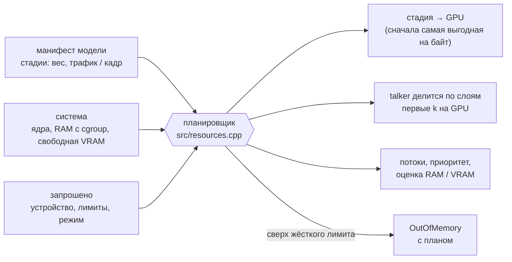
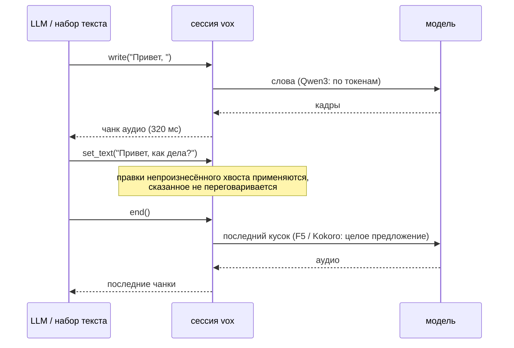

[English](README.md) | **Русский**

<p align="center">
  <picture>
    <source media="(prefers-color-scheme: dark)" srcset="docs/img/banner-dark.ru.svg">
    
  </picture>
</p>

<p align="center">
  <a href="https://github.com/dariumi/Vox/actions/workflows/ci.yml"></a>
  
  
  
  
</p>

<p align="center">
  <a href="https://dariumi.github.io/Vox/index.ru.html">Страница проекта и живое демо</a> ·
  <a href="#быстрый-старт">Быстрый старт</a> ·
  <a href="#модели">Модели</a> ·
  <a href="#производительность">Производительность</a> ·
  <a href="#что-проверено">Что проверено</a> ·
  <a href="CHANGELOG.md">Изменения</a>
</p>

**vox** — движок синтеза речи на C++17: C ABI (`include/vox.h`), CLI `vox`, Python-**библиотека** `vox`, HTTP/WebSocket-сервер и
браузерная библиотека `vox.js`. Без PyTorch, без ggml, без внешних библиотек: веса читаются через mmap из одного файла `.tmod`, голос хранится
в `.tvoice`. CPU (x86-64 AVX2, aarch64), Vulkan (NVIDIA / AMD / Intel / Android) и WebGPU в браузере; веса f32 / f16 / bf16 / q8 / q4.

| | |
|---|---|
| 🧩 **Несколько семейств моделей, один рантайм** | Qwen3-TTS (клонирование, готовые дикторы, голос по описанию), F5-TTS (клонирование, flow matching), Kokoro-82M (именные голоса и их смеси). Новые семейства подключаются на C++ или Python. |
| 🎛️ **Ресурсы под контролем** | устройство, лимиты RAM и VRAM, потоки и приоритет, режим (speed / balanced / memory / background); `vox plan` показывает, куда пойдёт каждая стадия, не загружая веса. |
| 🔁 **Стриминг в обе стороны** | текст может приходить по словам от LLM, аудио уходит чанками; правки ещё не произнесённого хвоста применяются. |
| 🎯 **Сверено с официальным кодом** | каждое семейство сравнивается по стадиям с официальной реализацией на PyTorch (см. [Что проверено](#что-проверено)). |
| 🎲 **Детерминированно** | шум и сэмплинг — Philox: аудио зависит только от seed, не от числа потоков и размера чанка; `vox.js` даёт те же отсчёты, что и ядро. |

## Архитектура



## Модели

| Модель | Голос | Языки | CPU | Vulkan | Браузер | Как сессия принимает текст |
|---|---|---|:-:|:-:|:-:|---|
| **Qwen3-TTS Base** 0.6B / 1.7B | клон по записи и её тексту | 10 (zh, en, ru, ja, ko, de, fr, …) | ✅ | ✅ | ✅ | по словам |
| **Qwen3-TTS CustomVoice** | готовые дикторы, инструкция о стиле (1.7B) | те же | ✅ | ✅ | ✅ | по словам |
| **Qwen3-TTS VoiceDesign** | голос по текстовому описанию | те же | ✅ | ✅ | ✅ | по словам |
| **F5-TTS** v1 / v0 и дообучения | клон по записи и её тексту | зависят от чекпойнта (база en/zh, русские дообучения) | ✅ | ✅ весь граф | ✅ | по предложениям |
| **Kokoro-82M** *(новое в 0.14)* | именные голоса из `voices/*.pt` и смеси `af_heart,bf_emma` | английский со встроенным G2P | ✅ | — | — | по предложениям / строкам |

В очереди: XTTS, CosyVoice, Chatterbox. Семейство описывает себя само (`vox inspect`, `engine.capabilities`), а нарезку,
кроссфейды и политику коммита берёт на себя движок.

## Быстрый старт

    cmake -S . -B build -DVOX_NATIVE=ON && cmake --build build -j
    pip install .                     # Python-модуль (nanobind, scikit-build-core, numpy)

Vulkan включается сам, если найдены заголовки (`libvulkan-dev`). SPIR-V шейдеры лежат в репозитории (`src/vk_shaders.inc`), glslang нужен только
при их изменении (`python tools/gen_shaders.py`). Termux: `pkg install clang cmake python python-numpy`, дальше так же (сборка под aarch64 проверяется в qemu).

<details>
<summary><b>Qwen3-TTS</b>: конвертация, клон голоса, синтез</summary>

    # 1. модель Hugging Face → .tmod (q8 самый быстрый на CPU; bf16 без квантования)
    python -m vox build --model ./Qwen3-TTS-12Hz-1.7B-Base --dtype bf16 --quant q8 -o model.q8.tmod

    # 2. голос по записи, нативно, без torch (лучше WAV 24 кГц, 5–15 с чистой речи)
    vox voice create ref.wav --model model.q8.tmod --text "Текст, который звучит в записи" \
        --name my_voice --lang russian --seed 42 -o voices/my_voice.tvoice

    # 3. синтез
    vox say "Привет! Это проверка." --model model.q8.tmod --voice voices/my_voice.tvoice -o out.wav
    vox say --stdin --stream --model model.q8.tmod --voice voices/my_voice.tvoice | ffplay -f f32le -ar 24000 -i -

    # 4. сервер (стриминг WAV/PCM, создание голоса через POST /v1/voices)
    python -m vox serve --model model.q8.tmod --voices ./voices --port 8080 --device vulkan

</details>

<details open>
<summary><b>Kokoro-82M</b>: конвертация, выбор голоса, синтез</summary>

    pip install misaki                      # необязательно: его словари встраиваются в .tmod для встроенного G2P
    python -m vox.build_kokoro --model ./Kokoro-82M --dtype bf16 -o kokoro.tmod     # config.json, kokoro-v1_0.pth, voices/*.pt
    vox say "Hello! This is Kokoro running in vox." --model kokoro.tmod --speaker af_heart -o out.wav
    vox voice speaker --model kokoro.tmod --speaker "af_heart,bm_george" -o blend.tvoice        # смесь двух голосов
    vox phonemize --model kokoro.tmod "It's 10 o'clock, Dr. Smith."                             # проверить G2P

</details>

<details>
<summary><b>F5-TTS</b>: конвертация, клон, синтез</summary>

    python -m vox.build_f5 --ckpt F5TTS_v1_Base/model_1250000.safetensors --vocab F5TTS_v1_Base/vocab.txt \
        --vocos vocos-mel-24khz/ --dtype bf16 --quant q8 -o f5.tmod
    vox voice create ref.wav --model f5.tmod --text "Текст, который сказан в ref.wav" -o me.tvoice
    vox say "Текст для озвучки" --model f5.tmod --voice me.tvoice --device vulkan -o out.wav [--nfe 32 --cfg 2 --sway -1 --speed 1]

</details>

Python:

```python
import vox
eng = vox.Engine("model.q8.tmod", device="vulkan:0")
voice = eng.clone_voice("ref.wav", "Текст референса", name="my_voice", seed=42)
voice.save("my_voice.tvoice")
audio = eng.synthesize("Привет!", voice)                 # numpy float32, 24 кГц
with eng.session(voice, seed=42) as s:                    # текст кусками → аудио по готовности
    s.feed("Первая фраза. "); chunks = list(s.ready())
    s.end(); chunks += list(s)

k = vox.Engine("kokoro.tmod")
audio = k.synthesize("Hello there!", k.speaker_voice("af_heart"), speed=1.1)
k.phonemize("Hello there!")        # {'phonemes': …, 'chunks': […], 'g2p': 'misaki' | 'builtin'}
```

## Производительность

Замер пользователя на vox 0.12.2 (`tools/run_full_check.py`, Ryzen 7 5700X + RTX 3050 6 ГБ, Qwen3-TTS 1.7B-Base, ~13 с речи), qwentts.cpp —
на той же машине и том же тексте:

<p align="center">
  <picture>
    <source media="(prefers-color-scheme: dark)" srcset="docs/img/qwen-rtf-dark.ru.svg">
    
  </picture>
</p>

<p align="center">
  <picture>
    <source media="(prefers-color-scheme: dark)" srcset="docs/img/qwen-memory-dark.ru.svg">
    
  </picture>
</p>

<details>
<summary>Таблица всех измеренных конфигураций</summary>

| Формат | Vulkan | Vulkan, `codec=cpu` | CPU |
|---|---|---|---|
| bf16 | 0.63 | 0.59 | 2.98 |
| q8 | 0.47 | 0.44 | 1.96 |
| q4 | 0.44 | 0.41 | 1.64 |

qwentts.cpp: CUDA 0.429 (RSS 2.97 ГБ), CPU 2.164 (RSS 7.1 ГБ). RSS vox q8: 0.47 ГБ на GPU, 2.4 ГБ на CPU.
q4 быстрее и занимает на треть меньше VRAM, но не проходит стандартный допуск (KL ≤ 0.02, top-5 ≥ 97%), поэтому по умолчанию q8.
</details>

F5-TTS на процессоре до и после 0.13 (DiT с настоящей шириной слоёв F5, но 2 слоя, 2 шага, 12,8 с звука, 2 ядра машины разработки):

<p align="center">
  <picture>
    <source media="(prefers-color-scheme: dark)" srcset="docs/img/f5-cpu-dark.ru.svg">
    
  </picture>
</p>

**Пока не измерено на железе:** F5 на настоящей видеокарте (GPU-граф 0.13) и Kokoro на настоящих весах. На 2-ядерной машине разработки,
на тестовой модели с настоящей шириной декодера и генератора Kokoro (генератор — ~88% времени), за время работы над 0.14 Kokoro ускорился с RTF 2.68 до 1.05.

## Как работает каждая модель

<details open>
<summary><b>Qwen3-TTS</b>: авторегрессионный talker → code predictor → потоковый декодер кодека</summary>



- **Весь пайплайн нативно**: создание голоса (мел-спектр, ECAPA-TDNN, энкодер Mimi с RVQ), talker, code predictor, потоковый декодер
  кодека. torch нужен только для эталонных проверок.
- **На GPU** talker и predictor целиком. Цикл predictor'а (15 проходов на кадр) — один dispatch с сэмплингом в шейдере, 2 синхронизации с хостом
  на кадр. Декодер кодека тоже целиком на GPU, один command buffer на чанк. `codec=cpu` уносит декодер на CPU параллельно с GPU.
- **Модели**: `tts_model_type` читается из чекпойнта. Base — клонирование; CustomVoice — диктор как строка `codec_embedding` (1.7B — ещё и с инструкцией);
  VoiceDesign — голос по описанию.

      vox voice speaker --model custom.tmod --speaker aiden --instruct "Speak slowly" -o aiden.tvoice
      vox say "Hello" --model design.tmod --instruct "A deep calm male voice" -o out.wav

- **Режимы декодера**: `--decoder stream` (по умолчанию) — непрерывное декодирование с прогревом последними 50 кадрами референса;
  `--decoder reference` — бит в бит схема `chunked_decode` из `qwen_tts` (куски по 300 кадров, 25 кадров контекста) для проверок и A/B-сравнений.
</details>

<details>
<summary><b>F5-TTS</b>: текст → DiT flow matching (NFE шагов, CFG) → Vocos</summary>



- **Шаг DiT — один command buffer на GPU** (с 0.13): входная проекция, свёрточный позиционный эмбеддинг, все блоки (AdaLN, q/k/v, RoPE,
  flash attention, FFN) и выход; Vocos тоже на GPU, на CPU только iSTFT. `VOX_F5_GPU=0` — старый путь.
- **Конфиг v0 / v1** (`F5TTS_Base` и дообучения вроде `hotstone228/F5-TTS-Russian`): `--model-cfg v0|v1`, конвертер угадывает по пути,
  неверный конфиг даёт шум. Модели, сконвертированные 0.12.1 и старше, пересоберите (CRLF в `vocab.txt`, паддинг Vocos).
- Параметры названы как в официальном коде: `nfe_step`, `cfg_strength`, `sway_sampling_coef`, `speed`, `cross_fade_duration`, `target_rms`,
  `use_epss`, `max_chars` — через `--extra` / `extra={...}`, короткие флаги CLI `--nfe --cfg --sway --speed`.
- Отличия от официального пайплайна: китайский переводится в пиньинь посимвольно, без словаря слов; нет обрезки тишины образца (берутся первые 12 с);
  `fix_duration` не поддерживается.
</details>

<details open>
<summary><b>Kokoro-82M</b> <i>(новое в 0.14)</i>: G2P → PL-BERT → просодия → iSTFTNet</summary>



- **Конвертация**: `python -m vox.build_kokoro --model DIR` читает `config.json`, чекпойнт `.pth` (weight norm сворачивается) и `voices/*.pt`.
  Все голоса попадают в `.tmod` как `voice.<имя>`. Если установлен `misaki` (или `--lexicons DIR` указывает на его данные), встраиваются и его
  американские и британские словари gold/silver. Остальные опции: `--dtype f32|f16|bf16`, `--no-g2p`.
- **Голоса**: `--speaker af_heart` или смесь `af_heart,bf_emma` (пакеты усредняются, как в `KPipeline`). Сервер показывает их в
  `GET /v1/voices` и принимает по имени. Британское произношение — если имя голоса начинается с `b` или задан `lang=en-gb`.
- **G2P**:
  - **Встроенный**: порт `misaki.en` на C++ — словари, правила ударения, основы `-s`/`-ed`/`-ing`, числа, валюты, время и разметка
    `[слово](/фонемы/)`, без spaCy и espeak. На `tests/data/g2p_en.txt` совпадает с misaki (без espeak) в 35 из 40 предложений и в 92.1% слов (US и GB).
    Вместо spaCy — эвристический POS-теггер; слова вне словаря раскладываются на словарные или произносятся по буквам.
  - **`misaki` в Python**: если он установлен, `vox.Engine` по умолчанию берёт его для Kokoro (`g2p="misaki"`, с запасным espeak, если он есть) — тогда куски
    в точности те, что дал бы `KPipeline`. Выбор явно: `g2p="builtin" | "misaki"`.
  - **Готовые фонемы**: `extra={"phonemes": true}` (или `--extra '{"phonemes":true}'`) обходит G2P.
- **Параметры** (`--extra` или именованные аргументы в Python): `speed`, `phonemes`, `lang` (`en-us` / `en-gb`; другие языки встроенный G2P отклоняет),
  `noise_file` (для проверок).
- **API**: `vox phonemize --model M [--lang en-gb] "текст"`, `vox_engine_phonemize()` в C ABI, `Engine.phonemize()` в Python.
- Каждый кусок синтезируется целиком, поэтому аудио выходит по кускам (строки, затем куски до 510 фонем).
</details>

## Ресурсы: устройство, память, режим

    vox devices [--json]                          # CPU, RAM, GPU с индексами и свободной видеопамятью
    vox plan --model m.tmod --mode memory --ram-limit 3GiB --vram-limit 2GiB     # план без загрузки весов
    vox say "…" --model m.tmod --voice v.tvoice --device gpu:1 --mode balanced --threads 6 --affinity 0-5 \
        --priority low --ram-limit 6GiB --vram-limit 3GiB --place codec=cpu --gpu-layers talker=14 --max-sessions 2
    --config resources.json                       # то же JSON-файлом; флаги командной строки его перекрывают



<details>
<summary>Подробнее: режимы, лимиты, устройства</summary>

- **Режимы**: `speed` — все ядра, потоки с активным ожиданием; `balanced` (по умолчанию) оставляет ядро системе;
  `memory` — вдвое меньше потоков без активного ожидания; `background` — четверть ядер с низким приоритетом, без GPU.
- **Лимиты жёсткие**: если план больше `ram_limit` / `vram_limit`, модель отклоняется (`OutOfMemory` с планом в тексте), если не задано
  `enforce=false`. Сессия, не влезающая в остаток лимита, не создаётся; `max_sessions` ограничивает их число. После загрузки на GPU
  mmap-страницы весов возвращаются системе (`--no-release` отключает).
- У каждого движка свой пул потоков CPU (привязка к ядрам, `nice`): два движка с разным числом потоков дают одинаковый результат.
- `--device cpu | auto | gpu[:N] | vulkan | vulkan:N`, плюс `,strict` (ошибка, если матрица не влезла) и `,codec=cpu`.
  Нумерация Vulkan не совпадает с nvidia-smi и CUDA — ориентируйтесь на имя из `vox devices`. Программные рендереры (llvmpipe) `auto` не выбирает.
- vox пишет в stderr, что ушло в VRAM и почему; тихого отката нет. Одно Vulkan-устройство на процесс.
- Python: `vox.devices()`, `vox.plan(model, vox.Resources(...))`, `vox.inspect(model)`, `eng.stats()`, `eng.benchmark(...)`;
  ошибки — `vox.VoxError`, `vox.OutOfMemory`, `vox.DeviceError`.
</details>

## Двусторонний стриминг

Текст можно подавать на лету и забирать аудио по готовности, а можно наоборот: печатать текст и получить одну запись.
«Сантехнику» берёт на себя движок: он знает, как модель принимает текст, и решает, что и когда ей отдать.



| Модель | как читает текст | что делает движок |
|---|---|---|
| Qwen3-TTS | по словам (`text_in: token`) | отдаёт слова по мере поступления, придерживает недописанное слово |
| F5-TTS, Kokoro | целыми кусками (`text_in: chunk`) | копит текст до конца предложения (или паузы в наборе `idle_ms`); с `auto` результат совпадает с синтезом всего текста сразу |

    with engine.duplex(voice, commit="auto", idle_ms=600) as d:       # Python
        d.write("Привет, "); d.write("как дела?"); d.end()           # из любого потока
        for chunk in d.audio(): play(chunk)                           # aaudio() для asyncio, final() — одна запись
    printf 'Привет. Как дела?' | vox live --model m.tmod --voice v.tvoice -o out.wav --commit sentence
    # HTTP: WebSocket /v1/duplex — {"type":"start"|"text"|"set_text"|"flush"|"end"|"cancel"}, аудио — бинарные кадры PCM

Политика коммита (`commit`): `auto` | `sentence` | `manual` (ничего не уходит до `flush()` / `end()`); конфликт с уже сказанным:
`keep` | `raise` | `respeak`.

## Браузер: vox.js

Один скрипт без зависимостей (`docs/vox.js`, ES-модуль `docs/vox.mjs`), который запускает **F5-TTS и Qwen3-TTS** на WebGPU, а без WebGPU переходит на JS-бэкенд для CPU.

```html
<script src="vox.js"></script>
<script type="module">
  const f5 = await Vox.load("hf:SWivid/F5-TTS", { dtype: "bf16", onProgress: (p) => console.log(p) });
  const voice = await f5.cloneVoice(refFile, "Текст, который сказан в записи");
  const { pcm, sampleRate } = await f5.synthesize("Привет, мир!", { voice, nfe_step: 16, seed: 1 });
  Vox.play(pcm, sampleRate);

  const q = await Vox.load("hf:Qwen/Qwen3-TTS-12Hz-0.6B-CustomVoice", { dtype: "bf16" });
  const v = q.speakerVoice(q.speakers[0], "", { language: "english" });
  for await (const piece of q.stream("Long text.", { voice: v, seed: 1 })) { /* куски аудио */ }
</script>
```

<details>
<summary>Загрузка по ссылке, кэш, нагрузка на GPU, ограничения</summary>

- `Vox.load` принимает репозиторий Hugging Face (`hf:org/name`, ссылку на страницу, `tree`/`resolve`), прямую ссылку, `.tmod`, `File`/`Blob` или набор файлов.
  Чекпойнты конвертируются в браузере теми же преобразованиями, что и конвертеры на Python (для Qwen3 — байт в байт по каждому тензору).
  Qwen3 читается по тензорам через HTTP Range блоками по 8 МиБ, шесть запросов параллельно, сразу в видеопамять; блоки кэшируются в Cache API, повторная загрузка ничего не качает.
- Опции: `dtype`, `quant: "q8"`, `token`, `hfHost`, `backend` (`auto` | `webgpu` | `cpu`), `load` (`balanced` | `gentle` | `full`),
  `cache`, `blockMiB`, `modelCfg` (F5 v0/v1). `Vox.convert(src)` возвращает байты `.tmod`.
- Работа отправляется срезами по ~30 мс с паузами, чтобы ОС, браузер и сторожевой таймер драйвера не страдали (`model.gpu.setLoad(...)`).
- Клонирование голоса Qwen3 Base по записи работает в браузере (`model.cloneVoice(audio, refText)` → `voice.toTvoice()`).
- Тот же `seed` даёт то же аудио, что `vox say --seed`.
- **Не проверено**: настоящие видеокарты и драйверы (тесты идут на SwiftShader), настоящие веса в браузере, Safari и Firefox, настоящий huggingface.co.
- Ограничения: вычисления в f32 (без f16 и cooperative matrix), KV-кэш в f32, у Qwen 16 обращений к видеокарте на кадр, q4 в браузере не собирается,
  запасной путь на CPU — однопоточный JS. Kokoro в браузере пока нет.
</details>

## Что проверено

Каждое семейство собирается крошечным из **официальных классов PyTorch** со случайными весами (те же модули, имена тензоров и поток данных,
что у настоящих чекпойнтов, только узкие) и сравнивается с vox по стадиям. CI гоняет это на CPU и на программном Vulkan (lavapipe).

| Семейство | Эталон | Результат |
|---|---|---|
| Qwen3-TTS | `qwen_tts` 0.1.1 (`generate_voice_clone`, `generate_custom_voice`, `generate_voice_design`) | speaker embedding ≤ 4e-7; коды референса совпадают на 100%; логиты talker / predictor ≤ 1e-6 / 1e-5, argmax 100%; аудио декодера ≤ 3e-4; на **настоящей 1.7B-Base**: логиты ≤ 2.6e-4, argmax 100% |
| F5-TTS | `f5_tts` + `vocos` | токенизатор, мел, текстовый энкодер, DiT (обе ветки CFG), Vocos, цикл CFM ~1e-6; сквозное аудио 3e-9; GPU-граф на lavapipe 4e-9; настоящий чекпойнт hotstone: аудио f32 1.8e-4 |
| Kokoro-82M | `kokoro` 0.7.16 + `misaki` 0.7.4 (`KModel`, `KPipeline`) | каждая стадия (PL-BERT, энкодер длительностей, длительности, F0/N, текстовый энкодер, выравнивание, источник NSF, STFT, генератор) до ~1e-6; во всех сквозных сценариях та же длина, log-mel 0.16–0.71 дБ (2.64 дБ при другом шуме); G2P — 92.1% слов против misaki |
| vox.js | ядро и официальные дампы | аудио F5 3.7e-9; конвертация Qwen3 байт в байт, аудио = `vox say --seed`; CPU-путь < 1e-4 |
| Привязки | `vox say --seed 42` | C, C++, Rust, Go, Node.js, Python ctypes — бит в бит |

`vox verify` прогоняет коды эталона с teacher forcing и сравнивает логиты каждого шага и аудио декодера; для q8 — средний KL (≤ 0.02) и
top-5 (≥ 97%) вместо argmax.

<details>
<summary>Полный прогон на вашей машине: <code>tools/run_full_check.py</code></summary>

    python tools/run_full_check.py --model-dir ./Qwen3-TTS-12Hz-1.7B-Base --ref-audio ref.wav \
        --ref-text "Текст референса" --lang russian --dtypes bf16,q8 \
        --devices "cpu;vulkan:1,strict;vulkan:1,codec=cpu,strict" --threads 8 \
        --external "qwentts.cpp=./qwentts-cli --model m.gguf --out {out} < {text_file}" \
        --external-time 'qwentts.cpp=\[Perf\] Total:\s*([\d.]+)\s*ms' \
        --wer --asr-cmd 'whisper-cli -m ggml-small.bin -l {lang} -nt -np -f {wav}' --out work/

Прогон конвертирует веса, нативно создаёт голос и сравнивает его с `qwen_tts`, снимает дампы PyTorch, проверяет каждую пару «формат × устройство»,
меряет скорость (холодный и тёплый старт, первый чанк, пиковая память, профили по стадиям и GPU), запускает внешний движок на том же тексте
и с `--wer` оценивает разборчивость через whisper. Результат — `work/report.md`. Профили: `VOX_PROFILE=1` (стадии CPU), `VOX_PROFILE=gpu`
(метки времени GPU по шейдерам), `VOX_PROFILE=f5`, `VOX_PROFILE=kokoro`.

Проверить референс до создания голоса: `python tools/check_reference.py ref.wav --ref-text "..."`. Лишнее слово в начале синтеза почти всегда
означает, что текст референса не совпадает с записью.
</details>

## Форматы

- `.tmod`: заголовок `VOXM`, JSON-манифест (стадии, точность, токенизатор, параметры генерации, голоса), блобы с выравниванием 4096 под mmap.
- `.tvoice`: safetensors с `speaker_emb`, `ref_codes`, `ref_text_tokens`, исходным WAV и параметрами по умолчанию, привязан к весам по sha256.
  Голос в режиме `speaker` (готовый диктор, описание, голос Kokoro или смесь) хранит имя диктора и привязан к варианту модели.
- **Q4**: 4 бита на вес, блоки по 32. `--quant q4` — внимание и MLP talker'а, `q4mlp` — только MLP, `q4full` — всё. На RTX 3050 он быстрее и
  занимает на треть меньше VRAM, но допуск KL/top-5 не проходит; WER на пяти фразах 0.12–0.18 против 0.07 у q8, на слух разницы в клонах нет.

## Из других языков

Все привязки идут через C ABI. В `examples/`: C (`minimal.c`), C++ (`minimal.cpp`), Rust (`rust/`), Go (`go/`, cgo), Node.js (`node/`, koffi),
Python ctypes. `tests/test_examples.py` собирает каждую и требует совпадения аудио с `vox say --seed 42` бит в бит.
Модель можно написать целиком на Python и зарегистрировать (`vox.register_family`): см. [docs/python-backends.md](docs/python-backends.md).

## Страница проекта

В `site/` лежат исходники [страницы проекта](https://dariumi.github.io/Vox/index.ru.html) с живым демо на WebGPU; `python tools/build_site.py` собирает её в `docs/`.
Примеры кода на странице вставляются прямо из `examples/`, то есть это те же файлы, что проверяют тесты. Графики строятся по замеренным числам
командой `python tools/make_charts.py`.

## Устройство кода

| путь | что |
|---|---|
| `include/vox.h` | C ABI: движок / голос / сессия, pull-стриминг, отмена, phonemize |
| `src/engine.cpp` | реализация ABI, сэмплинг, чанки, дуплексные сессии, конвейер «GPU генерирует, CPU декодирует» |
| `src/backend_qwen3.cpp`, `src/qwen3.cpp`, `src/qwen3_voice.cpp` | Qwen3-TTS: режимы prefill, talker, predictor, декодер; создание голоса (мел, ECAPA-TDNN, Mimi, RVQ) |
| `src/f5.cpp`, `src/f5_ops.cpp`, `src/backend_f5.cpp`, `src/gpu_f5.cpp` | F5-TTS: токенизатор, DiT + CFM, Vocos, нарезка текста и кроссфейд, граф DiT на Vulkan |
| `src/kokoro.cpp`, `src/backend_kokoro.cpp` | Kokoro-82M: PL-BERT, предиктор просодии, текстовый энкодер, декодер, генератор iSTFTNet |
| `src/kokoro_g2p.cpp`, `src/kokoro_g2p_en.cpp` | английский G2P (порт misaki.en) и нарезка на куски как в KPipeline |
| `src/resources.cpp`, `src/family.cpp` | планировщик ресурсов и бюджет сессий; реестр семейств моделей (C++ и Python) |
| `src/kernels.cpp` | пулы потоков, matmul (f32/f16/bf16, q8 и q4 int8-dot AVX2), трансформер (включая гибрид GPU/CPU) |
| `src/gpu_vulkan.cpp`, `src/gpu_codec.cpp`, `src/shaders/*.comp` | Vulkan: matmul, трансформер, декодер кодека, профайлер; шейдеры GLSL (SPIR-V в `src/vk_shaders.inc`) |
| `webgpu/wgsl/`, `webgpu/web/src/` | WGSL-шейдеры и исходники `vox.js` (`tools/build_web.py`) |
| `python/vox` | Python API, конвертеры `vox.build` / `vox.build_f5` / `vox.build_kokoro`, сервер `vox.serve`, фронтенд misaki |
| `site/`, `docs/` | страница проекта и её сборка для GitHub Pages; в `docs/img/` графики |
| `tools/` | эталоны, полный прогон, крошечные модели (`make_tiny_*.py`), графики |
| `tests/`, `examples/` | модульные и эталонные тесты; клиенты на шести языках |

## Тесты

    tests/run_all.sh          # C++, токенизатор, Qwen3 / F5 / Kokoro против официального кода (если стоят torch и пакеты),
                              # примеры на 6 языках, vox.js в Chromium (если есть playwright), Python, сервер, дуплекс, Q4
    VOX_QWEN2_GGUF=qwen2.gguf VOX_TEST_DEVICES="cpu;vulkan:0" python tests/test_official.py build/vox
    python tests/test_kokoro_tiny.py build/vox

Словарь для тестов: `curl -L -o qwen2.gguf https://raw.githubusercontent.com/ggml-org/llama.cpp/master/models/ggml-vocab-qwen2.gguf`.
CI (`.github/workflows/ci.yml`) гоняет всё это на CPU и на lavapipe.

## Ограничения

- GPU в нативных сборках — только Vulkan (CUDA и Metal нет); шейдеры общие, без тензорных ядер и cooperative matrix; одно Vulkan-устройство на процесс.
- **Kokoro**: только CPU (ни Vulkan, ни браузера пока нет); встроенный G2P только английский и на части слов расходится с misaki
  (эвристический теггер вместо spaCy, нет espeak). Настоящие веса Kokoro-82M во время разработки не проверялись (не было доступа к Hugging Face).
- F5-TTS на GPU на настоящей карте не измерялся; графу нужен `dim_head ≤ 64` (так у всех официальных чекпойнтов).
- Основной путь рассчитан на авторегрессионные кодековые модели; не-AR подключаются через режим «direct» `Backend` (так сделаны F5 и Kokoro). XTTS, CosyVoice и Chatterbox пока не подключены.
- Официальный `non_streaming_mode=True` (весь текст в prefill) не реализован. Python-бэкенд считает на CPU в интерпретаторе — для прототипов.
- Сэмплинг на GPU считает в float, на CPU — в double. Тот же seed на том же устройстве даёт то же аудио.
- Ресемплинг входа для голоса — sinc/Kaiser; бит в бит с `qwen_tts` (soxr) только для WAV 24 кГц.
- NFC-нормализация делается в Python-обёртке; из CLI и C ABI подавайте текст уже в NFC.
- Сборка aarch64 проверяется в qemu; пробы RAM/ядер для macOS и Windows не запускались.

## Лицензия

Apache-2.0 (см. `LICENSE`). `third_party/json.hpp` — nlohmann/json (MIT). Веса моделей распространяются на условиях своих лицензий и в репозиторий не входят.
